# GPSDO DDMTD front end -- handbook

**rev B, 2026-10-10.**  GENERATED by `gen/handbook.py`; do not edit.
Run `python3 build.py` (or `python3 gen/handbook.py`) to rebuild it.

Thirteen 10 MHz DDMTD channels and twelve 1 pps inputs on one board that plugs
onto the Raspberry Pi header of a PYNQ-Z2.  A 10.001234 MHz helper samples every
10 MHz reference, which stretches time by 8101: one helper cycle of beat
displacement is **12.34 ps** of input phase, and the FPGA measures the beat
edges with an ordinary counter.

Contents: [1 the header](#1-the-raspberry-pi-header) *
[2 a Si5351 on the bare PYNQ](#2-today-a-si5351-module-on-the-bare-pynq-z2) *
[3 the I2C bus](#3-the-i2c-bus) *
[4 the board](#4-the-board) *
[5 the thirteen channels](#5-the-thirteen-channels) *
[6 test points](#6-test-points-and-what-the-silkscreen-means) *
[7 power](#7-power-and-the-one-way-to-get-it-wrong) *
[8 bring-up](#8-bring-up-in-order) *
[9 using it](#9-using-it) *
[10 mechanical](#10-mechanical) *
[11 manufacturing](#11-manufacturing-and-the-drc)

---

## 1  The Raspberry Pi header

Every one of the forty pins is used: 8 ground, 2 x 5 V in, 2 x 3.3 V that we
deliberately leave open, I2C, the helper clock, thirteen beats and twelve pps.
Nothing is spare.  `*` marks the five pins section 2 needs.

```

    PYNQ-Z2, seen from ABOVE (component side up), its RPi header along the
    top edge.  Our board plugs onto that header and overhangs UPWARD in this
    picture -- away from the Zynq, out over the desk.

            <------------------------ 137.0 mm ------------------------>
            +----------------------------------------------------------+  ^
            |                    o  hole (4.3, 4.3)   o hole (133.3,4.3)|  |
            |  [audio][ USB-A ][  HDMI  ]  39 ........ 3 1   odd  row   |  |
            |                              40 ........ 4 2   even row   |  |
            |                                                          | 87.0
            |                                                          |  |
            |[ETH]                     Zynq                            |  |
            |[USB]                                                     |  |
            +----------------------------------------------------------+  v

    PIN 1 IS AT THE RIGHT-HAND END, on the row NEAREST the PYNQ-Z2's top edge
    (The PYNQ-Z2's own silkscreen prints "1  2" at the right end and 
    "40 39" at the left).  Odd pins are the PYNQ's OUTER row, even pins the inner.

    Our board carries the mating socket on its UNDERSIDE, so on OUR board the
    same pins run mirrored: looking down at our silkscreen, pin 1 is at the
    RIGHT of the socket, the odd row is the UPPER of the two, and every pin is
    named on the silkscreen beside its own pad -- odd names above the odd row,
    even names below the even row.
```

```
                                     +---------------+
        +3V3_HOST       1 | *   o | 2       +5V_HDR
          I2C_SDA W18   3 | *   o | 4       +5V_HDR
          I2C_SCL W19   5 | *   * | 6       GND
          BEAT_01 Y18   7 | o   o | 8  V6   PPS_01
              GND       9 | o   o | 10 Y6   PPS_03
          BEAT_03 U7   11 | o   o | 12 C20  PPS_05
          BEAT_05 V7   13 | o   o | 14      GND
          BEAT_07 U8   15 | o   o | 16 W6   PPS_07
        +3V3_HOST      17 | o   * | 18 Y7   HELPER_CLK
          BEAT_09 V8   19 | o   o | 20      GND
          BEAT_11 V10  21 | o   o | 22 F20  PPS_09
          BEAT_00 W10  23 | o   o | 24 F19  PPS_11
              GND      25 | o   o | 26 U19  PPS_00
          BEAT_02 Y16  27 | o   o | 28 Y17  PPS_02
          BEAT_04 Y19  29 | o   o | 30      GND
          BEAT_06 U18  31 | o   o | 32 B20  PPS_04
          BEAT_08 W8   33 | o   o | 34      GND
          BEAT_10 Y8   35 | o   o | 36 B19  PPS_06
          BEAT_12 W9   37 | o   o | 38 A20  PPS_08
              GND      39 | o   o | 40 Y9   PPS_10
                                     +---------------+

   *  = needed to drive a bare Si5351 module (section 2)
```

| pin | net | Zynq | what it is |
|---:|:---|:---|:---|
| 1 | `+3V3_HOST` | -- | NOT CONNECTED - we make our own 3.3 V |
| 2 | `+5V_HDR` | -- | board power in |
| 3 | `I2C_SDA` | W18 | I2C SDA - 2k2 pull-up already on PYNQ-Z2 |
| 4 | `+5V_HDR` | -- | board power in |
| 5 | `I2C_SCL` | W19 | I2C SCL - 2k2 pull-up already on PYNQ-Z2 |
| 6 | `GND` | -- | ground |
| 7 | `BEAT_01` | Y18 | unit 2 beat |
| 8 | `PPS_01` | V6 | unit 2 pps |
| 9 | `GND` | -- | ground |
| 10 | `PPS_03` | Y6 | unit 4 pps |
| 11 | `BEAT_03` | U7 | unit 4 beat |
| 12 | `PPS_05` | C20 | unit 6 pps |
| 13 | `BEAT_05` | V7 | unit 6 beat |
| 14 | `GND` | -- | ground |
| 15 | `BEAT_07` | U8 | unit 8 beat |
| 16 | `PPS_07` | W6 | unit 8 pps |
| 17 | `+3V3_HOST` | -- | NOT CONNECTED |
| 18 | `HELPER_CLK` | Y7 | HELPER CLOCK -> FPGA (MRCC P, bank 13) |
| 19 | `BEAT_09` | V8 | unit 10 beat |
| 20 | `GND` | -- | ground |
| 21 | `BEAT_11` | V10 | unit 12 beat |
| 22 | `PPS_09` | F20 | unit 10 pps |
| 23 | `BEAT_00` | W10 | unit 1 beat |
| 24 | `PPS_11` | F19 | unit 12 pps |
| 25 | `GND` | -- | ground |
| 26 | `PPS_00` | U19 | unit 1 pps |
| 27 | `BEAT_02` | Y16 | unit 3 beat |
| 28 | `PPS_02` | Y17 | unit 3 pps |
| 29 | `BEAT_04` | Y19 | unit 5 beat |
| 30 | `GND` | -- | ground |
| 31 | `BEAT_06` | U18 | unit 7 beat |
| 32 | `PPS_04` | B20 | unit 5 pps |
| 33 | `BEAT_08` | W8 | unit 9 beat |
| 34 | `GND` | -- | ground |
| 35 | `BEAT_10` | Y8 | unit 11 beat |
| 36 | `PPS_06` | B19 | unit 7 pps |
| 37 | `BEAT_12` | W9 | unit 13 beat |
| 38 | `PPS_08` | A20 | unit 9 pps |
| 39 | `GND` | -- | ground |
| 40 | `PPS_10` | Y9 | unit 11 pps |

---

## 2  TODAY: a Si5351 module on the bare PYNQ-Z2

With no front-end board yet, a Si5351 breakout wired to five pins of the
PYNQ-Z2's own header exercises the entire software path: the I2C driver, the
synthesiser programming, the PLL lock check, the overlay, and the measurement
core's helper counter.  Everything in `gateware/driver/i2c_devices.py` except
the thermometers, the 1-Wire bridge and the heater DAC.

```
    pin 1   +3V3_HOST    -> VIN / VDD on the module.  3.3 V, NOT 5 V (pins 1 and 17 are the same net; use either)
    pin 3   I2C_SDA      -> SDA   (the PYNQ already has the 2k2 pull-up)
    pin 5   I2C_SCL      -> SCL   (the PYNQ already has the 2k2 pull-up)
    pin 6   GND          -> GND
    pin 18  HELPER_CLK   -> CLK0  -- the helper output.  MRCC ball, and the one the gateware is built for
```

The PYNQ-Z2 already carries 2.2 kOhm pull-ups on SDA and SCL (R305-R308), so
the module's own pull-ups may be left fitted or removed; both work.

Take 3.3 V from **pin 1** or **pin 17**.  Those are the two pins the finished
board leaves open on purpose -- it makes its own 3.3 V from the 5 V pins -- so
using them now does not teach you a habit you have to unlearn.  Do not feed
the module 5 V: the Si5351 is a 3.3 V part.

CLK0 is the helper output.  Wiring it to **pin 18** puts it on `Y7 (IO_L13P_T2_MRCC_13)`,
a clock-capable (MRCC) ball and the one the gateware's constraint file is
built for, so the helper counter reads a real frequency instead of zero.  Pin
31 (`U18`) is the header's other MRCC ball; this board carries a beat on it
and fits nothing for a second helper input, but that is where a future
revision's fallback would go.

    ssh xilinx@<pynq>
    cd ~/gpsdo-dmtd
    ./pynq-run bringup.py --scan          # who answers on the bus
    ./pynq-run bringup.py --no-heater     # program the Si5351, check lock

`bringup.py` asks the chip which board it is on (`--rev auto`): a breakout's
crystal is on XA, so it reads as rev A and gets rev A's image -- the helper on
CLK0, the null on CLK1.  Add `--clk2 helper` and the third output carries a
second copy of the helper, so a scope or an ADALM2000 on CLK1 and CLK2 sees
1234.4 Hz of beat -- the number this whole instrument is built on -- with no
board in the system.  It is off by default, and refused on rev B, whose CLK2
is `HO`.

    ./pynq-run bringup.py --no-heater --clk2 helper   # on the PYNQ
    python3 gateware/board/m2k_beat.py                # on the laptop

`m2k_beat.py` drives an ADALM2000 over libiio (no Scopy, no libm2k) and
measures the beat from the PHASE RAMP between the two channels rather than by
subtracting two 10 MHz frequencies: both channels share one ADC clock, so the
ramp cancels it.  Round 30 measured 1234.417 Hz against 1234.400 by design.
Leave `gateware/board/console_log.py` running during a long session -- it logs
the PYNQ's serial console across resets, and distinguishes "Linux crashed"
from "the board lost power".

Expect the scan to show **0x60** and nothing else; with no front-end board the
thermometers, the DS2482 and the DAC are all absent, and `bringup.py` says so
rather than failing.  After programming, the core's helper counter should read
10.001234 MHz +/- a few ppm (a Si5351 breakout's crystal is not a TCXO; the
real board's is).

---

## 3  The I2C bus

| address | device | on the board |
|:---|:---|:---|
| 0x18 | DS2482-100 1-Wire bridge | U6001, behind the five screw terminals |
| 0x48 | TMP1075 #0 | U5001, left edge, by unit 1 |
| 0x49 | TMP1075 #1 | U5002, right edge, by unit 2 |
| 0x4A | TMP1075 #2 | U5003, left edge, between units 5 and 7 |
| 0x4B | TMP1075 #3 | U5004, right edge, by unit 6 |
| 0x4C | TMP1075 #4 | U5005, left edge, by unit 11 |
| 0x4D | TMP1075 #5 | U5006, right edge, between units 10 and 12 |
| 0x4E | TMP1075 #6 | U5007, centre line, beside the helper fan-out: the thermostat's sensor |
| 0x4F | TMP1075 #7 | U5008, bottom-left corner, below unit 13 |
| 0x60 | Si5351 helper synthesiser (A on rev A, C on rev B) | U3001, on the helper block at the centre line |
| 0x61 | MCP4725 heater DAC (A0 high) | U5009, in the housekeeping block |

Addresses are fixed by strapping on the board; the eight TMP1075 differ only
by their address pins, and their numbering runs with their position -- see the
plan in section 4.

---

## 4  The board

```
    0         20        40        60        80        100       120       140       160       180       200
  0 +-------------------------------------------------------+--------------------------------------+--------+
  4 | +-----------------------------------+                 |           [GND][+5V]                 |    (O) |
  8 | |    [W1]   [W2]  [W3]   [W4]  [W5] |    +-----------------+                                 |        |
 12 | |                                   |    |  (HIN)    (HO)  |                                 |        |
 16 |(O)                                  |    |            |    |                           [15 V JACK]    |
 20 | |                                   |    |            |    |                                 |        |
 24 | |                                   |    |            |    |             POWER               |        |
 28 | |     1-WIRE THERMOMETERS           |    |            |    |                                 |        |
 32 | +-----------------------------------+    |            +----|---------------------------------+        |
 36 |                                          |                 |                                          |
 40 |                                          |                 |                                          |
 44 |      (P1)          (1)                   |                 |                                          |
 48 |                                          |                 |                                          |
 52 |                                          |                 |                    (2)          (P2)     |
 56 |                                          |                 |                                          |
 60 |                                          | HELPER          |                                          |
 64 |      (P3)          (3)                   | CLOCK           |                                          |
 68 |                                          | FAN-OUT         |                                          |
 72 |                                          |                 |                    (4)          (P4)     |
 76 |                                          |                 |                                          |
 80 |      (P5)          (5)                   |                 |                                          |
 84 |                                          |                 |                                          |
 88 |                                          |                 |                    (6)          (P6)     |
 92 |                                          |                 |                                          |
 96 |                                          |                 |                                          |
100 |      (P7)          (7)                   |                 |                                          |
104 |                                          |                 |                                          |
108 |                                          |                 |                    (8)          (P8)     |
112 |                                          |                 |                                          |
116 |      (P9)          (9)                   |                 |                                          |
120 |                                          |                 |                                          |
124 |                                          |                 |                   (10)         (P10)     |
128 |                                          |                 |                                          |
132 |      (P11)        (11)                   |                 |                                          |
136 |                                          |                 |                                          |
140 |                                          |                 |                                          |
144 |                                          |                 |                   (12)         (P12)     |
148 |                                          |                 |                                          |
152 |                   (13)                   +-----------------+                                          |
156 |     (O)                                                                                               |
160 |                                                                                                       |
164 |                  +---------------------------------+                                                  |
168 |                  |                                 |                                                  |
172 |                  |      HOUSEKEEPING               |                             [=]                  |
176 |            [DEBUG 2x10]                            |    [ RPi 2x20 SOCKET, UNDERSIDE ]         (O)    |
180 +------------------+---------------------------------+--------------------------------------------------+

    (n)  10 MHz SMA for unit n        (Pn)  that unit's 1 pps SMA
    (HIN)/(HO)  external helper in / HO out (CLK2, buffered)
    [Wn] 1-Wire screw terminal        (O) M3 hole   [=] M3 slot
    numbers down the left and across the top are millimetres
```

Every connector is on an edge, and every edge is one kind of thing:

* **top edge, left**: five 3-way screw terminals for external 1-Wire probes.
* **top edge, right**: the 15 V heater jack, and the two bench 5 V posts that
  are normally left empty.
* **left and right columns**: the SMAs.  Each unit is a horizontal strip
  pointing inward at the helper on the centre line: 1 pps jack, 1 pps
  circuit, 10 MHz jack, 10 MHz circuit, helper.  Odd units down the left,
  even units down the right, so the numbers run 1..13 down the board.
* **bottom edge**: the 2x20 socket (on the underside), and the 2x10 debug
  header.

---

## 5  The thirteen channels

| unit | 10 MHz SMA | 1 pps SMA | source | shunt, source running | beat net | pin | ball | pps net | pin | driver slot |
|---:|:---|:---|:---|:---|:---|---:|:---|:---|---:|:---|
| 1 | `1` | `P1` | Spectrum Instruments TM-4 | **50R** | `BEAT_00` | 23 | W10 | `PPS_00` | 26 | beat 0, pps 16 |
| 2 | `2` | `P2` | ZED-F9T #1 | **none** (never 50R) | `BEAT_01` | 7 | Y18 | `PPS_01` | 8 | beat 1, pps 17 |
| 3 | `3` | `P3` | ZED-F9T #2 | **none** (never 50R) | `BEAT_02` | 27 | Y16 | `PPS_02` | 28 | beat 2, pps 18 |
| 4 | `4` | `P4` | Leo Bodnar LBE-1421 #1 | **50R** | `BEAT_03` | 11 | U7 | `PPS_03` | 10 | beat 3, pps 19 |
| 5 | `5` | `P5` | Leo Bodnar LBE-1421 #2 | **50R** | `BEAT_04` | 29 | Y19 | `PPS_04` | 32 | beat 4, pps 20 |
| 6 | `6` | `P6` | LB Precision GPS Ref 2021 | **50R** | `BEAT_05` | 13 | V7 | `PPS_05` | 12 | beat 5, pps 21 |
| 7 | `7` | `P7` | LB Mini Precision | **50R** | `BEAT_06` | 31 | U18 | `PPS_06` | 36 | beat 6, pps 22 |
| 8 | `8` | `P8` | BG7TBL GPSDO green 2019 | **50R** | `BEAT_07` | 15 | U8 | `PPS_07` | 16 | beat 7, pps 23 |
| 9 | `9` | `P9` | TM4313 | **50R** | `BEAT_08` | 33 | W8 | `PPS_08` | 38 | beat 8, pps 24 |
| 10 | `10` | `P10` | ZYT GPSDO (Samsung UCCM) | **50R** | `BEAT_09` | 19 | V8 | `PPS_09` | 22 | beat 9, pps 25 |
| 11 | `11` | `P11` | TF-GNSSDO-10 IRIG-B | **50R** | `BEAT_10` | 35 | Y8 | `PPS_10` | 40 | beat 10, pps 26 |
| 12 | `12` | `P12` | HP 10811B / FE-5680A Rb | **50R** | `BEAT_11` | 21 | V10 | `PPS_11` | 24 | beat 11, pps 27 |
| 13 | `13` | -- | NULL CHANNEL | **50R** | `BEAT_12` | 37 | W9 | -- | -- | beat 12 |

The shunt column is for a RUNNING source.  **Whenever a channel's source is
off or unplugged, its shunt goes on PARK** -- the third rule below.

Unit 13 is the **null channel**: no 1 pps, and its 10 MHz input is meant to be
cabled from `HO` -- the Si5351C's CLK2 at exactly 10.000000 MHz, through a
74LVC1G125 and 33 R -- into the jack marked `13` (`J1301`) with a short
SMA cable.  Subtracting it removes everything common to the board and leaves
the difference between the GPSDOs, which is the measurement.

### The 50R/PARK header is the one thing you can break something with

Every channel is populated identically -- `R_S` is a 0R link and `R_SH` is 2k2 --
so the only thing that differs between channels is where the shunt sits on
its three-pin header, `JPk01` for unit k.  Rev B prints what the header does
instead of its name (which is on the assembly drawing), beside the pins:
**`50R` at pin 1's end, which is the end toward the SMA on both columns,
`PARK` at pin 3's**, and a tick at pin 2, the common ground.

| shunt | pins | what it does | for |
|:---|:---|:---|:---|
| **50R** | 1-2 | 51R from the input node to ground: the 50 ohm termination | a running source that drives 50 ohm; the null channel |
| **none** | -- | the input sees `R_SH`, 2k2, alone | a running ZED-F9T, and nothing else |
| **PARK** | 2-3 | 100k from the squarer's gate to ground: the gate sits at ~0.14 V, out of its linear region, and draws nothing | every channel whose source is off or unplugged |

Three rules, and the first two are the only ways to damage something from
this board:

* **Units 2 and 3 (ZED-F9T): NEVER 50R.**  TIMEPULSE is 5 mA absolute
  maximum and 3.3 V into 50R asks for 66 mA.  Unterminated, the load is
  `R_SH` alone: 1.5 mA.  (Their IN U.FL into a 50 ohm scope adds 3.1 mA, 4.6 mA
  in all: leave it unplugged on these two; S and SQ show what matters.)
* **A source over 4.1 Vpp open circuit gets 50R BEFORE its cable goes on**:
  unit 1 (Spectrum Instruments TM-4, 8.0 Vpp), unit 8 (BG7TBL GPSDO green 2019, 4.2 Vpp), unit 11 (TF-GNSSDO-10 IRIG-B, 4.3 Vpp), and the bench OCXO (6.0 Vpp).  Unterminated, the TM-4's
  8.0 Vpp rectifies through the gate's ESD diode into the coupling
  capacitor and floats the input to about +7.4 V, past the gate's 6.5 V
  absolute maximum.  PARK does not prevent that: it biases the gate, it does
  not terminate the input.  With 50R, the TM-4 delivers 2.00 Vpp.  **This is
  why the silkscreen prints the board's 4.1 Vpp ceiling and not a source's
  open-circuit rating** -- they are different numbers and only one is a limit.
* **A channel with nothing driving it is PARKED, not left on 50R.**  A 50R
  shunt does not quiet the gate: with its source off, the gate sits at its
  threshold and draws 10-15 mA, exactly as with no shunt at all.  Every channel
  driven or parked: +3V3_A carries 160-250 mA of the TPS7A2033's 300 mA.
  Nothing driven or parked: 290-420 mA, through its 360 mA minimum current
  limit, and up to ~520 mA through F2001, a 500 mA polyfuse that trips sooner
  when warm.  Each idle unparked channel adds 10-15 mA: three at a time stay
  inside the 300 mA at the budget's worst case, about seven typically.  The
  first power-up is all thirteen on PARK.


### Expected levels, channel by channel

| unit | source | at the SMA | at the squarer input | slew rate | load | IN U.FL into 50 ohm |
|---:|:---|:---|:---|:---|:---|:---|
| 1 | Spectrum Instruments TM-4 | 2.00 Vpp, center 0 V | 2.00 Vpp, center 1.65 V | 63 mV/ns | 51R || 2k2 = 49.8 ohm | 95 mVpp |
| 2 | ZED-F9T #1 | 3.30 Vpp, center 1.65 V | 3.30 Vpp, center 1.65 V | ~1650 mV/ns | 2k2 only (1.5 mA peak) | leave unplugged |
| 3 | ZED-F9T #2 | 3.30 Vpp, center 1.65 V | 3.30 Vpp, center 1.65 V | ~1650 mV/ns | 2k2 only (1.5 mA peak) | leave unplugged |
| 4 | Leo Bodnar LBE-1421 #1 | 1.64 Vpp, center 0.82 V | 1.64 Vpp, center 1.65 V | ~820 mV/ns | 51R || 2k2 = 49.8 ohm | 78 mVpp |
| 5 | Leo Bodnar LBE-1421 #2 | 1.64 Vpp, center 0.82 V | 1.64 Vpp, center 1.65 V | ~820 mV/ns | 51R || 2k2 = 49.8 ohm | 78 mVpp |
| 6 | LB Precision GPS Ref 2021 | 2.30 Vpp, center 1.15 V | 2.30 Vpp, center 1.65 V | ~1150 mV/ns | 51R || 2k2 = 49.8 ohm | 110 mVpp |
| 7 | LB Mini Precision | 1.20 Vpp, center 0.60 V | 1.20 Vpp, center 1.65 V | ~600 mV/ns | 51R || 2k2 = 49.8 ohm | 57 mVpp |
| 8 | BG7TBL GPSDO green 2019 | 2.60 Vpp, center 0 V | 2.60 Vpp, center 1.65 V | 82 mV/ns | 51R || 2k2 = 49.8 ohm | 124 mVpp |
| 9 | TM4313 | 2.00 Vpp, center 0 V | 2.00 Vpp, center 1.65 V | 63 mV/ns | 51R || 2k2 = 49.8 ohm | 95 mVpp |
| 10 | ZYT GPSDO (Samsung UCCM) | 1.50 Vpp, center 0 V | 1.50 Vpp, center 1.65 V | 47 mV/ns | 51R || 2k2 = 49.8 ohm | 71 mVpp |
| 11 | TF-GNSSDO-10 IRIG-B | 2.20 Vpp, center 0 V | 2.20 Vpp, center 1.65 V | 69 mV/ns | 51R || 2k2 = 49.8 ohm | 105 mVpp |
| 12 | HP 10811B / FE-5680A Rb | 1.56 Vpp, center 0 V | 1.56 Vpp, center 1.65 V | 49 mV/ns | 51R || 2k2 = 49.8 ohm | 74 mVpp |
| 13 | NULL CHANNEL | 1.65 Vpp, center 0.82 V | 1.65 Vpp, center 1.65 V | ~825 mV/ns | 51R || 2k2 = 49.8 ohm | 79 mVpp |

---

## 6  Test points and what the silkscreen means

Every test point is a 1.5 mm pad with its key printed beside it.  The keys are
one character each except the 10 MHz input's, which is `In`: at 1.5 mm in
KiCad's stroke font a capital `I` and a `1` are the same three strokes, and
this board has jacks called `1`.

| letter | net / node | where | what you should see |
|:---|:---|:---|:---|
| **In** | `TP_IN` | 10 MHz box, beside the SMA ([picture](docs/handbook/unit1.png)) | the input as it arrives: 0.7-3.3 Vpp AC, 10 MHz.  4.1 Vpp is the board's ceiling; a 50 ohm source's OPEN-CIRCUIT rating is a different number and is not what arrives here -- see the jumper note |
| **S** | `TP_SQ` | 10 MHz box, at the squarer's input ([picture](docs/handbook/unit1.png)) | a sine or a rounded triangle, NOT a square: this is the squarer's INPUT, AC coupled about the gate's own threshold (1.65 V by design; rev A's sit near 1.4 V); 0.6-3.3 Vpp.  PARKED: ~0.14 V DC, still.  The squared signal is on the U.FL marked SQ (rev B; 1k, so /21 into a 50 ohm scope).  This is the node whose slew rate sets the channel's noise floor, and a 10x probe's ~20 pF through the 330 R rounds what you see (round 41: a 10x probe divides the resistance by ten, not the capacitance) |
| **B** | `TP_BEAT` | 10 MHz box, at the far end ([picture](docs/handbook/unit1.png)) | 0/3.3 V square at the beat frequency, 1234.4 Hz |
| **P** | `TP_PPS` | 1 pps box ([picture](docs/handbook/pps.png)) | 0/3.3 V, one rising edge a second |
| **5** | `TP_5V` | power block, by the 5 V fuse ([picture](docs/handbook/rails.png)) | 4.6-5.3 V |
| **A** | `TP_3V3_A` | power block, at the analog LDO ([picture](docs/handbook/rails.png)) | 3.25-3.35 V.  Absent, by design, when the host is off |
| **D** | `TP_3V3_D` | power block, at the digital LDO ([picture](docs/handbook/rails.png)) | 3.25-3.35 V.  Absent, by design, when the host is off |
| **X** | `TP_REF` | helper block, at the Si5351C's CLKIN ([picture](docs/handbook/ref.png)) | 0/3.3 V HCMOS, 25 MHz: the TCXO, through 33 R, straight into CLKIN (rev B items 9 and RA1).  Rev A drove XA through a 3k3/1k divider instead, and that slow edge was the PLLA slip mechanism (round 45.20, O3) |
| **W** | `TP_1W` | 1-Wire block, on the bus | the DS18B20 bus: idle high at 3.3 V, with the conversion traffic on it |

The two SMA ranges, which the board also prints along the bottom:

* 10 MHz in: 0.7 to 3.3 Vpp AC **at the SMA** -- that is the
  range the thirteen sources in this inventory actually present, each with its
  own jumper setting.  The board's ceiling is 4.1 Vpp: R_S is a link on
  every channel, so the swing at the SMA is the swing at the gate, and the gate
  tolerates a diode drop outside each rail.  A source's OPEN-CIRCUIT rating is
  a different number and is not a limit on this connector -- the TM-4 is
  8.0 Vpp open circuit and 2.0 Vpp at the SMA through its mandatory
  50 ohm jumper.  Round 29 printed the 8.0 on the silkscreen, which was
  backwards: see the jumper note above.
* 1 pps in: 0 to 5.5 V DC; it reads high above 2.3 V (the 74LVC1G17's
  worst-case 2.08 V through the 1k/10k divider; round 45 measured 1.88-1.98 V
  at the jack).
* `HO` out: 0/3.3 V from a 74LVC1G125 through 33 R: ~1.8 Vpp into 50 ohm,
  3.3 Vpp into a high impedance.  Into 50 ohm the buffer sources ~30-35 mA
  peaks, over its 24 mA rating: fine for the null channel's short cable and a
  counter, not for a long run into a 50 ohm instrument.

### The U.FL taps

Rev B puts a U.FL on every node worth watching for longer than a probe can be
held (item 19).  Each is fed through its own resistor, so the ratio is built
in: a stock U.FL-to-BNC pigtail into a **50 ohm** input reads the node /21
through 1k.  Into 1 MOhm the pigtail's ~50-100 pF and the 1k roll a 10 MHz
signal off; use 1 MOhm for the rails.  Unplugged, a tap costs its node under
0.02 % of its amplitude.  The silkscreen names each one beside it; their J
numbers are on the assembly drawing only.

| U.FL | where | node | series | into a 50 ohm scope | plugging it in |
|:---|:---|:---|:---|:---|:---|
| **IN** | each 10 MHz box, between the SMA and the 50R/PARK header ([picture](docs/handbook/unit1.png)) | the input node, on the SMA side of the 10n: the same node as `In` | 1k | the input /21: the last column of the levels table | 1050 ohm on the input, 2-5 % of its amplitude, 50-100 ps while plugged in.  Not on units 2 and 3 (the jumper note's first rule) |
| **SQ** | each 10 MHz box, beside the sampling flip-flop ([picture](docs/handbook/unit1.png)) | the squarer's output 1Y, the edge the flip-flop samples | 1k | a 0/3.3 V square /21, ~0.15 Vpp; near 50 % duty when the input is centred on the threshold.  Parked: ~0.16 V DC | ~3 mA from an unbuffered gate's output: it moves that channel's edge while plugged in |
| **REF** | helper band, between the TCXO and the Si5351C ([picture](docs/handbook/ref.png)) | the TCXO at the Si5351C's CLKIN | 1k | 25 MHz HCMOS /21, ~0.15 Vpp | 3 mA from the TCXO: common to every channel |
| **CLK0** | helper band, just below the Si5351C ([picture](docs/handbook/clk0.png)) | the helper at the Si5351C's pin, before the helper squarer's 10n | 1k | 10.0012344 MHz, 0/3.3 V /21 | load on the Si5351's own 2 mA output -- load on its outputs is what made rev A slip.  A look, not a long watch: use HCLK for that |
| **HCLK** | helper band, beside the lower LMK1C1108 (U3005) ([picture](docs/handbook/hclk.png)) | a spare LMK1C1108 output, through 33 R like every channel's branch | 33R | the helper as every channel gets it: ~1.2 Vpp (the LMK's 50 ohm output and the 33 R against the scope's 50) | ~12 mA from the fan-out's supply, which every channel's branch shares: plug it in before a run and leave it, rather than during one |
| **+5V, +3V3_A, +3V3_D** | bottom edge, in the housekeeping block, left to right ([picture](docs/handbook/rail_taps.png)) | the rails; +3V3_A at the far end of its plane, under unit 13 | 1k | DC /21 (0.24, 0.16, 0.16 V) and the ripple /21; into 1 MOhm the rail itself | 3-5 mA: nothing |

---

## 7  Power, and the one way to get it wrong

The board is **normally powered from the PYNQ-Z2**, through pins 2 and 4 of
the header.  Nothing else needs to be plugged in for the measurement to run.

The 15 V barrel jack is for the **heater only**.  It never touches the analog
rails, and the board works without it; the heater is what makes the board a
thermostat rather than a thermometer.

The two bench 5 V posts are an alternative to the header's 5 V, for using the
board on a desk with no PYNQ attached.  **They are the trap**, and round 21
found it: an unpowered Zynq I/O pin has an absolute maximum of 0.55 V (PYNQ-Z2
user manual, table 15), so bench-powering the board while the PYNQ is plugged
in but switched off drives 3.3 V into twenty-six of them.

Round 28 made that impossible rather than merely warning about it: the two
LDOs' ENABLE pin is tied to the header's own 5 V through R2025, so **with the
host off, this board makes no 3.3 V at all**, whatever is on the bench posts.
R2026 (a DNP 0R link) bridges ENABLE back to the input for anyone who wants
the old behaviour on a board that will never see a host.

**The bench posts as an ammeter.**  With the PYNQ ON, a bench supply on the
posts at 5.3 V, limited to 0.5 A, carries the whole board: the posts and the
header meet at an OR-ing diode and the higher one wins.  Its display is then
the board's current, which at the first power-up is the one number that says
the thirteen squarers are parked and nothing is shorted.  Bench output off
before the PYNQ goes off.

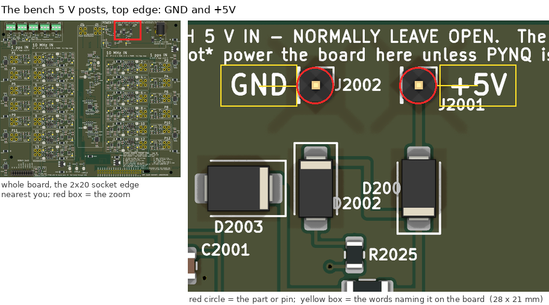

Order of operations, every time:

1. Everything off.  The shunts set -- the first time, **all thirteen on
   PARK**.  This board onto the PYNQ-Z2's header.  Never plug it onto, or pull
   it off, a powered PYNQ.
2. The PYNQ-Z2 on, from **its own barrel jack J9** with the jumper at `REG`,
   not from micro-USB alone.  This board's 3.3 V rails come up with it.
3. `./pynq-run bringup.py` -- which writes the heater DAC's EEPROM to zero
   BEFORE anything else, because the part ships at mid-scale and that is
   1.65 V on three FET gates.
4. The sources, one at a time: the shunt to its setting FIRST (50R, or none
   for a ZED-F9T), then the cable, then the source on.  A source that goes off
   for long puts its shunt back on PARK.
5. Only then the 15 V jack (the picture is in section 8, step 9).

Power down in reverse: the 15 V jack, the bench supply if there is one, the
PYNQ.  The sources may stay cabled to a board that is off: each reaches its
squarer through a 10n, and the squarer's inputs have no diode to their supply.

---

## 8  Bring-up, in order

Rev B's first board.  Each step says what to read and what it should be; stop
at the first one that is not.

Every picture here is cut from the board's own 3D render
(`gen/handbook_figs.py`), drawn as the board sits behind the PYNQ-Z2: **the
2x20 socket's edge nearest you**, the screw terminals and the 15 V jack
furthest away.  On the left, the whole board and a red box; on the right, that
box: the red circle is the part or pin, the yellow box the words the board
prints for it.  The build checks every one of them: those words must be beside
that part, and nearer it than any other part of its kind -- another test
point, U.FL, jack or pin.

1. **Before power, on the bench.**  Ohmmeter on the socket's pads from the
   top, where each pin's name is printed.  Pins 1 and 17 (`nc`) connect to
   nothing on this board: each reads open to pin 2 (`5V`) and to pin 6
   (`GND`).  Then the rails: the `+5V` post, test point `A` and test point
   `D` each to the `GND` post (pictures in step 2 and section 7) read high,
   not a short.

   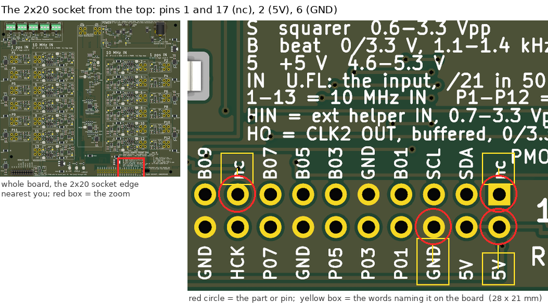

   **All thirteen shunts on PARK**: pins 2-3, the end of each header with
   `PARK` printed beside it -- on every unit the end AWAY from its SMA.
   Thirteen shunts a board ship loose in the bag, plus spares.

   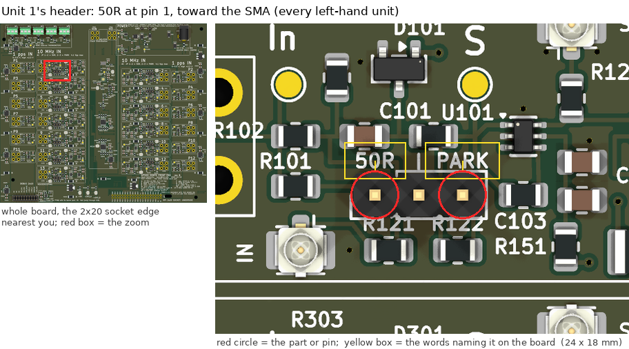
   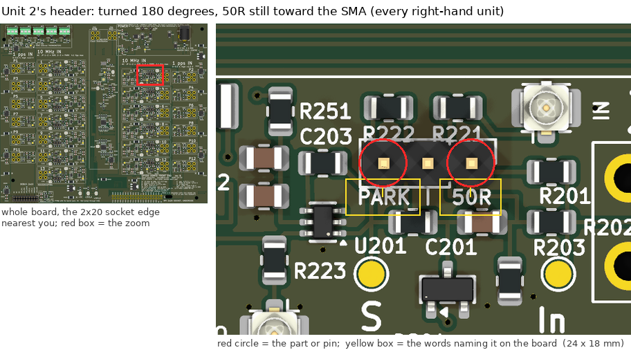

2. **First power.**  Board on the header, PYNQ off; a bench supply on the
   posts at 5.3 V, 0.5 A limit, output off.  The PYNQ on, then the bench
   output on.
   * The bench display: **0.25-0.35 A** with every channel parked (+3V3_A
     160-220 mA, +3V3_D ~100 mA, both through their LDOs).  Over 0.45 A:
     everything off, and look for a channel that is not parked, or a short.
   * Test point `5` 4.9-5.3 V; `A` and `D` 3.25-3.35 V; the `+3V3_A` U.FL,
     at the far end of the plane, a few tens of mV below `A` at most (rev A
     lost 110 mV in its tracks; rev B's is a plane).

     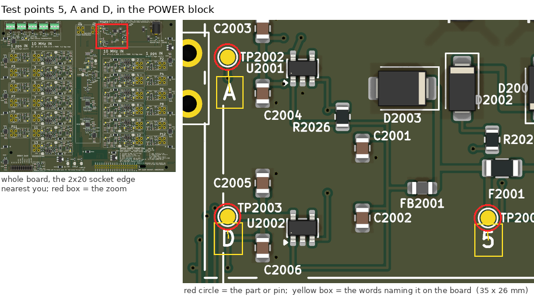
     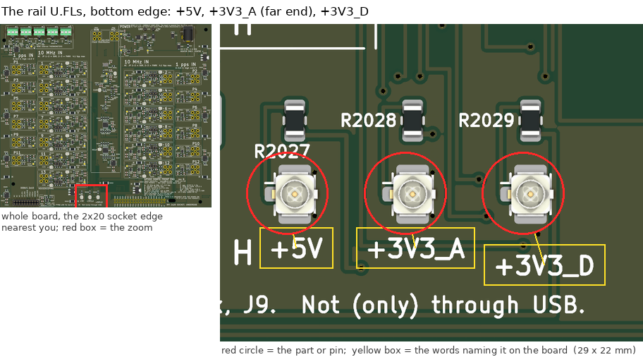

   * `S` on every unit: **~0.14 V DC, still** -- parked.  The left-hand units
     (odd numbers) all look like unit 1, the right-hand ones like unit 2.

     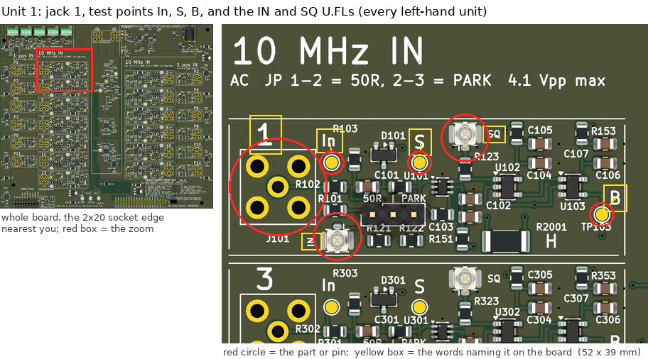
     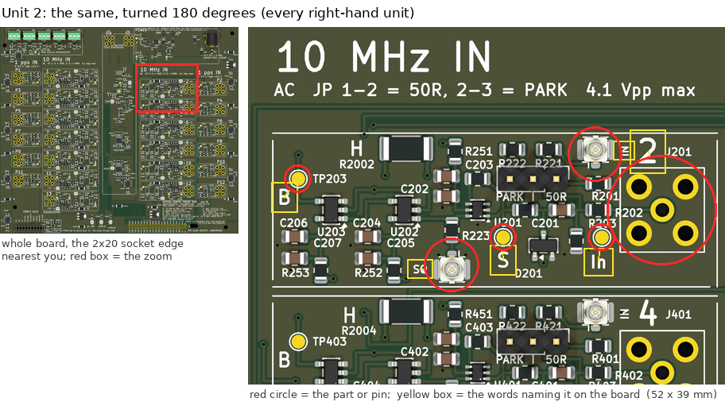

   * `X`: 25 MHz, 0/3.3 V.

     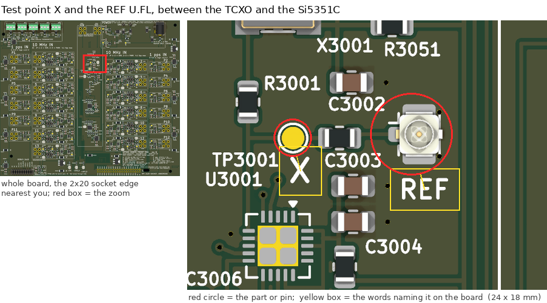

3. **`./pynq-run bringup.py`.**  In order: every address in section 3
   answering; the DAC made safe; "reference seen on: CLKIN (rev B)"; both
   PLLs LOCKED; **zero helper slips**; eight thermometers within a few
   kelvin of each other; the 1-Wire bus idle high with no short; and the
   selftest with all thirteen channels quiet -- a parked squarer makes no
   beat, and that is a pass.  "Locked" is not enough on its own: round 39's
   first board cycle-slipped ~650 times a second with LOL clear, so
   `bringup.py` counts the slips and reprograms if it sees any.  It reads the
   board off the chip (`--rev auto`); if it says the reference is on NEITHER
   input, the TCXO is not running: look at `X`.
4. **The reference and the helper.**
   * `REF` U.FL into 50 ohm (beside `X`, picture in step 2): 25 MHz,
     ~0.15 Vpp; on a counter 25 MHz +/- 62 Hz (the TCXO's 2.5 ppm).
   * `HCLK` U.FL: the helper as every channel gets it, 10.0012344 MHz; the
     core's helper counter 10.001234 MHz.  For a long look use HCLK, not CLK0
     (section 6).

     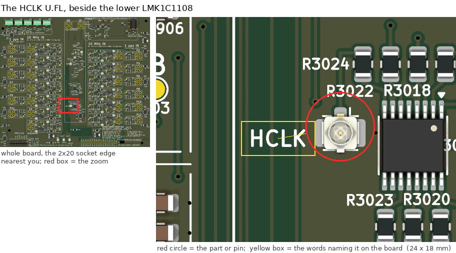
     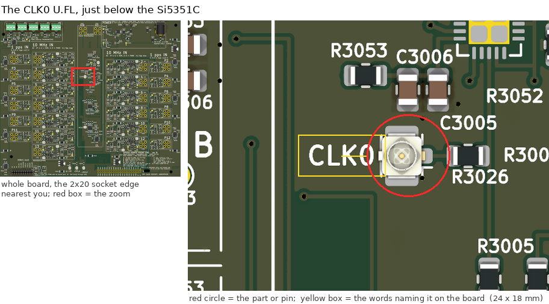

   * `HO` on a counter: 10.000000 MHz.

     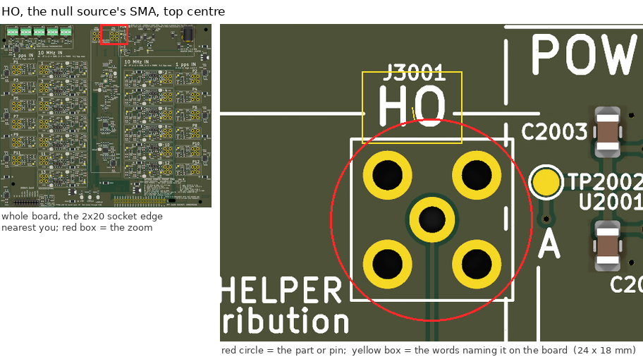

5. **The null channel first.**  Unit 13's header from PARK to 50R, then a
   short SMA cable from `HO` to the jack marked `13` (`J1301`).
   `./pynq-run bringup.py --no-heater --inputs 13`, then
   `./pynq-run beats.py record 20 13`.  Its beat should be 1234.4 Hz and
   its phase reading flat: that is the instrument floor, and everything else
   is measured against it.  On unit 13, `S` shows the square about the
   threshold and the `SQ` U.FL a 0/3.3 V square /21 near 50 % duty.  Judge a
   beat by `python3 beats.py analyse` on the laptop, not by the edge count:
   the core does not deglitch yet, so a real beat's edges chatter (round 39:
   2-6 rising edges a transition).  `./pynq-run si_watch.py watch 600 13`
   is the long test of both PLLs.

   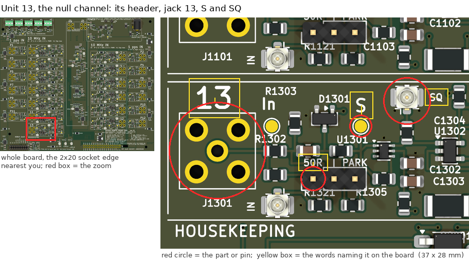

   *One comparison worth making*: the same with unit 13's shunt OFF
   instead of 50R.  HO's 33 R already back-terminates the cable, so its far
   end may be left open: the null input then sees 3.3 Vpp with twice the
   slew, and the buffer stops sourcing its ~35 mA peaks from +3V3_D.  If the
   floor is no worse, run the null channel that way.
6. **The sources, one at a time** (section 5's table, and the header's three
   rules): the shunt first, then the cable, then the source on.  For each,
   on that unit (pictures of units 1 and 2 in step 2): the board's current up
   by a few mA, not 10-15 (a driven gate is out of its linear region most of
   each cycle); the `IN` U.FL the source as it arrives, /21 (the levels
   table's last column; not on units 2 and 3); `S` the sine or triangle
   about the threshold; `SQ` a square near 50 % duty; a beat.  A channel
   left on 50R with its source off is quiet, chatters, or oscillates at
   ~0.57 MHz, and draws its 10-15 mA: park it.
7. **One source into two channels** through a splitter: the two readings
   should differ by a constant, not a drift (`beats.py`, "pairs").
8. **Each unit's own pps** against its own 10 MHz edge.  The `P` jacks are
   the outer column on each side; `P` is the test point.

   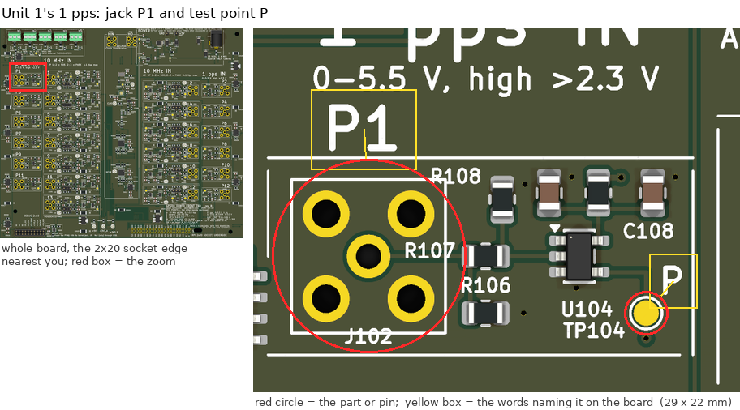

9. **The heater, last.**  With the DAC made safe by step 3, the 15 V jack;
   then `./pynq-run heater.py on`: ~9.6 W, and every thermometer rises.
   U5007 (0x4E), beside the fan-out and marked `T`, is the sensor rev B's
   thermostat will hold (item 20); the loop is still to be written
   (`Heater.duty_cycle` is its helper).  `heater.py off` before the jack
   comes out.

   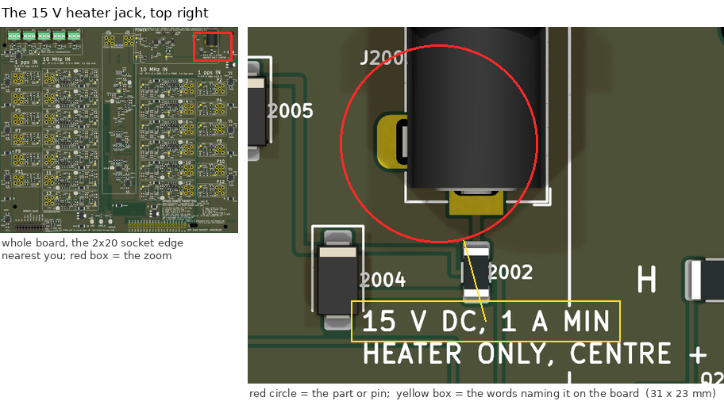
   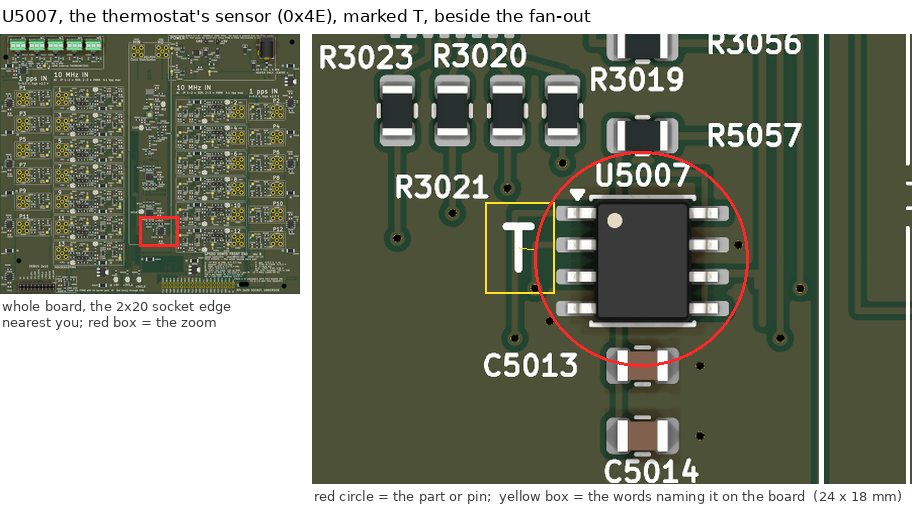

---

## 9  Using it

```python
from driver import attach
core = attach(overlay)
snap = core.snapshot()          # every channel, one coherent instant
```

* 13 beat channels in slots 0..12, 12 pps returns in slots
  16..27; slot 12 is the null channel.
* One helper cycle of beat displacement is 12.3425 ps of input phase, and the
  measurement wraps at 100000 ps -- one whole 10 MHz cycle.
* The beat frequency is 1234.4 Hz by design; in service it is re-centred in
  software from the measured helper frequency, because a +/-2.5 ppm TCXO is
  +/-25 Hz of beat.

---

## 10  Mechanical

Board: **207.0 x 180.0 mm**, 4 layers, 1.6 mm.  It rides 8.0 mm above the
PYNQ-Z2 on the socket, and overlaps only the 11.0 mm strip along the
PYNQ's top edge, so everything tall on the PYNQ stays in open air.

| at (mm) | kind | what it is for |
|:---|:---|:---|
| (4.0, 16.0) | 3.2 mm hole | M3 desk standoff, upper left - NOT the corner: J6001's terminal block reaches to x = 3.75 there, and moving the terminal row instead cost a routed I2C bus (round 29) |
| (201.5, 5.5) | 3.2 mm hole | M3 desk standoff, top-right corner |
| (196.0, 174.5) | 3.2 mm hole | M3 desk standoff, bottom right - 11 mm in, not 5.5, to stay off the HTR_DRIVE spine that runs down x = BW - 6.2 |
| (13.0, 157.0) | 3.2 mm hole | M3 desk standoff, lower left - the corner itself is under U5008's decoupling stack, and the six margin lanes occupy x = 1.4 to 9.4 |
| (168.3, 173.3) | 3.2 x 7 mm slot | M3 SLOT onto the PYNQ-Z2's own top-right mounting hole: the one standoff shared with the host.  A slot, not a hole, because the registration between the two boards runs through a 2x20 header and a set of photograph-derived dimensions good to about a millimetre |

A desk standoff must be clear of the PYNQ-Z2's own outline, which on this
board means clear of x 35..172 in the bottom 11 mm; the shared one is the
opposite, and screws into the host's own hole.  The PYNQ's OTHER mounting
hole, at board (39.3, 173.3), is underneath the 2x10 debug header and cannot
be drilled; the 2x20 header plus the one slot locate this board against the
host in both axes anyway.  Hardware per board: four M3 standoffs to the desk
or the base plate, one M3 screw through the slot into the PYNQ's own
standoff.

---

## 11  Manufacturing, and the DRC

The DRC this project runs is set from `gen/jlc.py`, one row per rule, and every
row asserts that our number is at least as strict as JLCPCB's published
capability for a standard 4-layer FR-4 board.  A board that passes our DRC is
inside their capability by construction.

| rule | JLCPCB minimum | our DRC | margin | why |
|:---|---:|---:|:---|:---|
| copper clearance | 0.0889 mm | 0.15 mm | 69% over | 3.5 mil is JLC's 4-layer minimum; 0.15 is set by the finest pitch here, the Si5351C's 0.5 mm QFN-20 (rev A: an MSOP-10), whose own pads sit 0.25 mm apart |
| track width | 0.0889 mm | 0.2 mm | 125% over | every track on this board is 0.25 (signal) or 0.5 (power); 0.2 is the floor the DRC enforces |
| via diameter | 0.4 mm | 0.6 mm | 50% over | one via size on the board: 0.6 mm pad, 0.3 mm drill |
| via annular ring | 0.13 mm | 0.15 mm | 15% over | (0.6 - 0.3)/2 = 0.15 exactly |
| plated hole diameter | 0.2 mm | 0.3 mm | 50% over | smallest drill on the board is the 0.3 mm via; the SMA and header pins are 1.0-1.7 mm |
| hole to copper | 0.254 mm | 0.254 mm | as JLC | JLC's figure for a multilayer board, adopted unchanged |
| hole edge to hole edge | 0.5 mm | 0.5 mm | as JLC | JLC's figure, adopted unchanged; round 28 made it an ERROR after two vias were drilled into through-hole pads and only warned |
| copper to board edge | 0.2 mm | 0.3 mm | 50% over | JLC routs to +/-0.2 mm, so 0.3 keeps copper off the bit |
| silkscreen to exposed copper | 0.15 mm | 0.15 mm | as JLC | JLC's own DFM check: ink over a solder-mask opening is SCRAPED OFF, so a clipped letter is not a warning, it is a missing letter |
| silkscreen text height | 0.8 mm | 0.8 mm | as JLC | JLC print 0.8 mm; below that the strokes merge.  1.0 mm is their recommendation and is what every label on this board except the reference designators uses |
| silkscreen stroke width | 0.1524 mm | 0.155 mm | 2% over | 6 mil, and the one rule where the honest number is not round: every piece of text this project draws is 0.16 or more, and round 29 raises the stock footprints' own 0.12 mm graphic outlines to 0.16 as they are placed -- no KiCad rule checks a graphic line's width, only text's |
| solder-mask sliver | 0.1 mm | 0.1 mm | as JLC | JLC publish no figure; 0.1 mm is IPC-2221 class 2 and is what their DFM flags in practice |

Two things KiCad does not check and this project therefore does itself:

* **silkscreen line width.**  KiCad's stock footprints draw their outlines at
  0.12 mm, below JLCPCB's 6 mil minimum, and no DRC rule looks at a graphic
  line's width -- only at text.  `pcb/build_pcb.py` raises every silkscreen
  stroke below 0.16 mm as the footprint is placed.
* **what the silkscreen SAYS.**  Every label on this board is emitted from the
  same table that places the part it refers to, so a heater's `H` cannot end
  up beside a different heater and a jack's name cannot outlive the jack.

### Assembly, and the one number to look at before ordering

The closest SMT pad to the board edge is **1.20 mm**, on `Q2003`.  No KiCad rule checks this -- `copper_edge_clearance` is about copper, not about whether a placement nozzle and an edge clamp can both reach -- and it is the one figure in this project that is NOT comfortably inside a published capability.  JLCPCB's SMT line holds the panel by its edges; if 1.20 mm is inside their rail allowance the board needs a break-away rail, which is a different panel and a different price.  Ask them rather than moving the part: `Q2003` is where it is because of what it decouples.

Everything nearer the edge than that is through hole -- the SMA jacks, the
five screw terminals, the barrel jack and the two bench posts -- and JLCPCB
fits it on the top side.  Bottom side: the 2x20 socket, J4001, and nothing
else; it is the one part soldered by hand (`hand_solder_bom.csv`).  The
thirteen jumper shunts ship loose.
