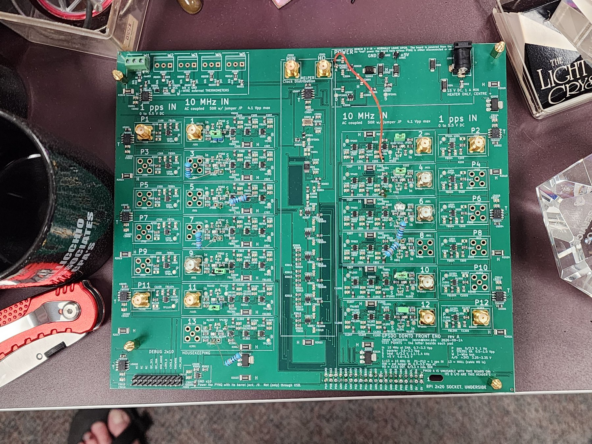
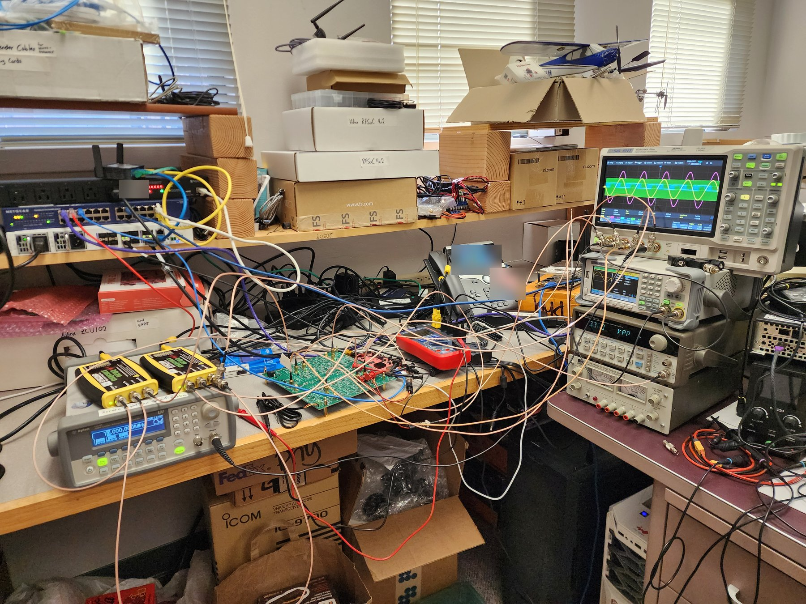
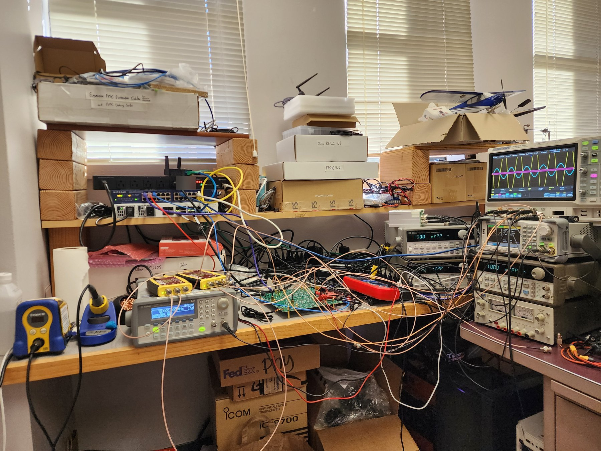
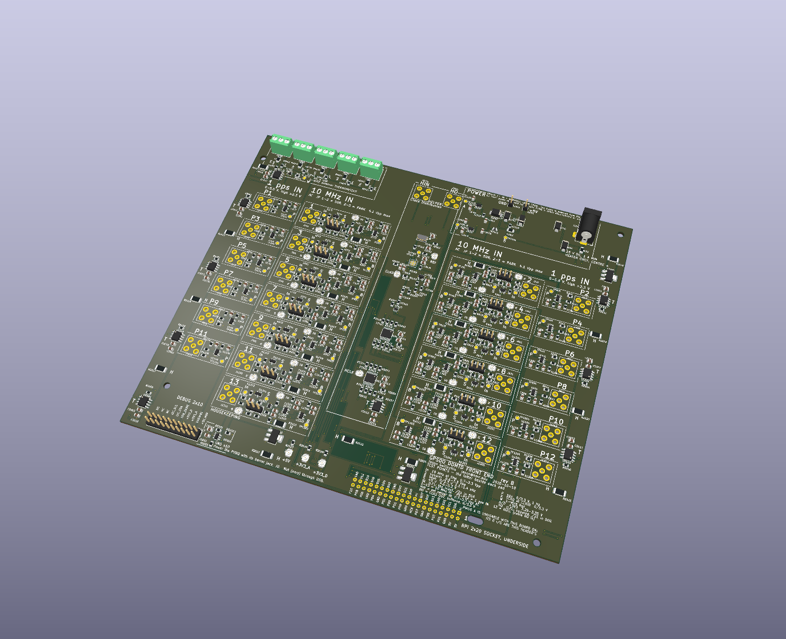
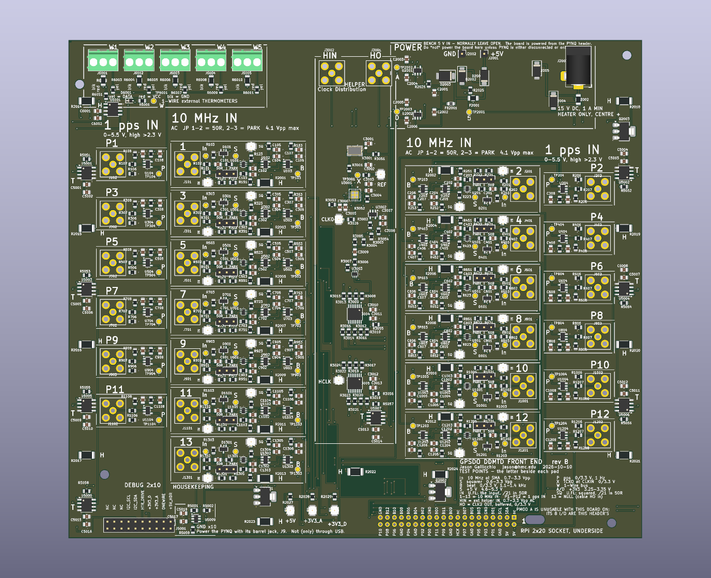
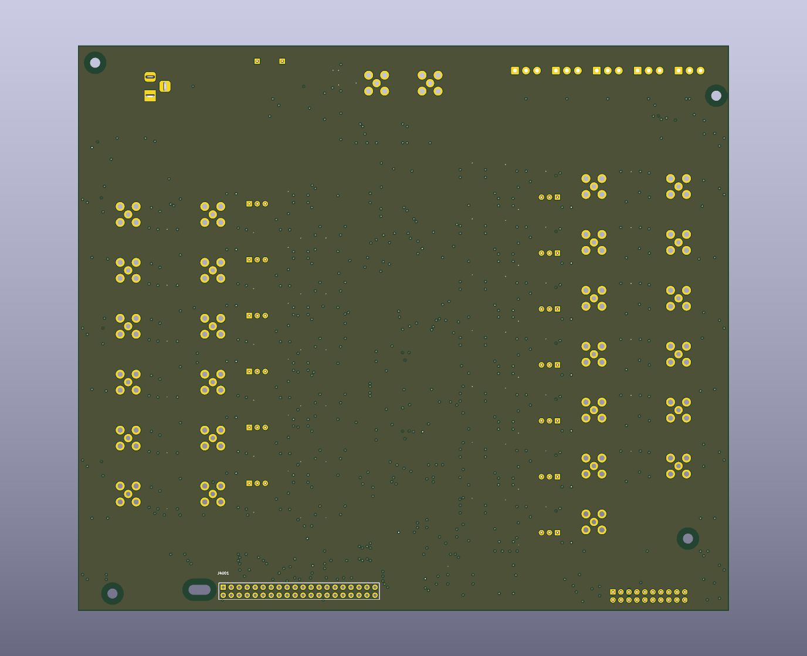
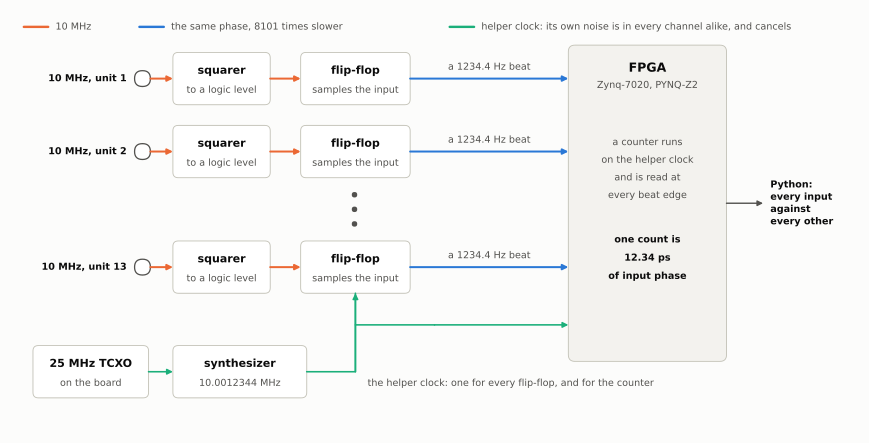
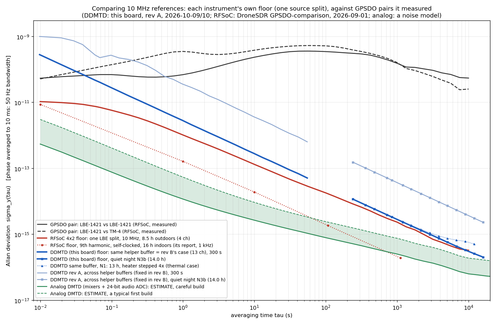

# GPSDO-PYNQ-Z2

**Compare up to 13 GPS Disciplined Oscillators: 10 MHz and 1PPS**

A board for a [PYNQ-Z2](http://www.pynq.io/boards.html) that measures the phase of thirteen 10 MHz references
against each other in 12 ps steps, with a floor below a picosecond. Rev A is built and measured. **Rev B is in
hand, and has not been tested yet.**

Rev A after its bench life: the red wire and the blue resistors are the repairs.

<table>
<tr>
<td width="50%"></td>
<td width="50%"></td>
</tr>
<tr><td colspan="2">Rev A on its PYNQ-Z2, being measured against generators and a scope, October 2026.</td></tr>
</table>

Rev B, as drawn in KiCad:

  

Click any image to open it at full size.

## At a glance

| | |
|---|---|
| Inputs | 13 x 10 MHz and 12 x 1 pps, on SMA |
| Method | digital dual-mixer time difference (DDMTD), one helper clock for every channel |
| Step | 12.34 ps a count |
| Floor, rev A | Allan deviation 2.8e-12 at 1 s, 2.8e-15 at 1000 s; time deviation 0.18 ps at 1 s |
| 1 pps | a 10 ns counter across all twelve |
| Host | PYNQ-Z2 (Zynq-7020), on its Raspberry Pi header; a Python driver |
| Board | 207 x 180 mm, 4 layers, 27 SMA jacks, 5 V from the PYNQ |
| Cost | about $246 for two assembled (rev B's estimate, bare boards extra) |
| Status | rev A: built, repaired by hand, measured. Rev B: in hand, untested |

The files in this repository are rev B. Rev A is the tag `GPSDO-PYNQ-Z2-revA` and
[`GPSDO-PYNQ-Z2-revA.zip`](GPSDO-PYNQ-Z2-revA.zip).

## How it works

- **A helper clock 1234.4 Hz away from 10 MHz** samples every input in a flip-flop.
- **Each input comes out as a 1234.4 Hz beat** with the same phase, stretched 8101 times in time.
- **A plain counter in the FPGA** times the beat edges. No carry chains, no calibration: one count is 12.34 ps.
- **The helper is common to every channel**, so its own noise cancels when two channels are compared.
- **Only slow beats cross to the FPGA.** The 10 MHz never leaves the board.

## What rev A measured

One oven oscillator split to several inputs, so the inputs agree and what is left is the board.

| | measured |
|---|---|
| One beat edge, two inputs from one source | 5.4 ps rms: the counter's own step |
| Allan deviation | 2.8e-12 at 1 s, 2.8e-13 at 10 s, 2.8e-15 at 1000 s (50 Hz bandwidth) |
| Time deviation | 0.18 ps at 1 s, 0.06 ps at 10 s, 0.19 ps at 1000 s |
| Against two GPSDOs' own difference | the floor is 25 times below it at 1 s, 800 times at 10 s |

- These are for channels on the same helper buffer. Rev A has five buffers, and across them it is 12 times
  worse at 1 s. Rev B has one tree.
- **No GPSDO has been through this board yet.** The GPSDO curves were taken on another instrument.
- How it was measured: [`analysis/floor_compare/`](analysis/floor_compare/README.md).

## What rev A got wrong

| fault | on rev A | in rev B |
|---|---|---|
| The synthesizer slipped cycles while reporting lock | cured by a lower output drive, in software | a synthesizer with a proper clock input |
| Inputs with nothing plugged in oscillate | resistors added by hand | a parking jumper on every input |
| The analog 3.3 V had no plane | a strap wire | a plane |
| The 10 MHz monitor output leaks into the channels | kept at low drive | isolated |
| Five helper buffers: channels differ by group | measure within a group | one fan-out tree |

All of it, with the measurements: [`REVB_CHANGES.md`](REVB_CHANGES.md).

## Made with an AI

This was Jason's first board designed with an AI.

- **Nothing is drawn by hand.** About 18,000 lines of Python and Verilog generate the nineteen schematic
  sheets, place every part, route every track, and write the release, the handbook and the gateware.
- **The whole conversation is kept**: 46 rounds of prompts and answers, mistakes included, in
  [`docs/DESIGN_LOG.md`](docs/DESIGN_LOG.md).
- **Three other models reviewed it** before the order: [`design_review/`](design_review/README.md).

What it took to get a working board:

| what went wrong | how it was found |
|---|---|
| A release with no ground planes and no mounting holes passed every check | looking at a render |
| "0 violations" hid 598 errors | making the design-rule check ask more |
| Part rotations for assembly were wrong for six rounds | JLCPCB's own placement preview, the only authority |
| The synthesizer slipped while "locked" | the first real signals on the bench |

| | dates | days |
|---|---|---|
| Rev A design, to the order at JLCPCB | 2026-09-08 to 2026-09-15 | 8 |
| Rev A bring-up and measurement | 2026-09-30 to 2026-10-10 | 11 |
| Rev B design | 2026-10-09 to 2026-10-10 | 2 |
| Rev B ordered | 2026-10-22 | |

Jason Gallicchio, with Claude (Anthropic's Opus 5, Fable 5.1 and Opus 5.5, in Claude Code).

## What is here

| path | what |
|---|---|
| `*.kicad_sch`, `GPSDO-PYNQ-Z2.kicad_pcb` | the KiCad project, rev B |
| [`HANDBOOK.md`](HANDBOOK.md) | every connector, jumper and test point, and how to bring a board up |
| [`mfg/release/`](mfg/release/) | what was uploaded to JLCPCB: Gerbers, BOM, placement |
| [`gateware/`](gateware/README.md) | the Verilog, the Vivado build, the Python driver, the bench programs |
| `gen/`, `pcb/`, `mfg/` | the scripts that generate the design (`python3 build.py`) |
| [`analysis/`](analysis/floor_compare/README.md) | the floor, and how it compares |
| [`docs/DESIGN_LOG.md`](docs/DESIGN_LOG.md) | the design log: every prompt and answer |
| [`photos/`](photos/README.md) | rev A on the bench |

The board grew up in a private repository of the research group. Its commits are here; vendor datasheets are
not. Commit hashes quoted in the documents are the old ones: [`docs/COMMIT_MAP.tsv`](docs/COMMIT_MAP.tsv).

## Licence

Hardware under CERN-OHL-P-2.0, software under MIT: [`LICENSE`](LICENSE).
