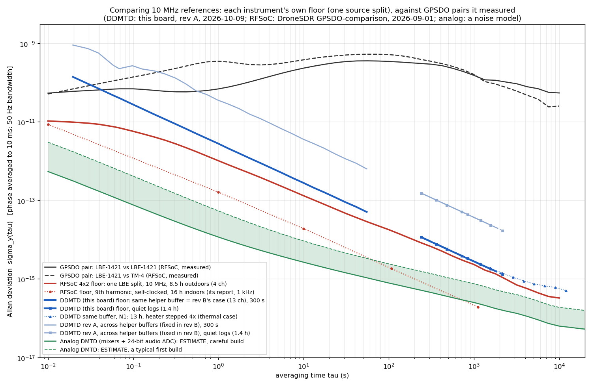
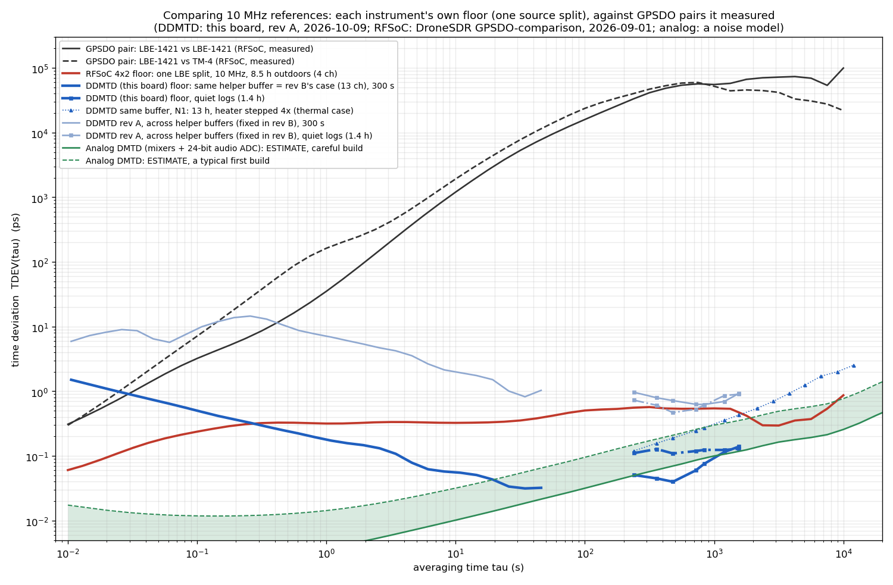

# Measurement floors: this board (DDMTD) vs the RFSoC 4x2 vs an analog DMTD

2026-10-09 (GPSDO-PYNQ-Z2 README 45.25).  `floor_compare_adev.png` and
`floor_compare_tdev.png`, from `floor_compare.py` (the numbers) and
`floor_plot.py` (the figures).

## What is on the plots

| Curve | Source | Measured? |
|---|---|---|
| DDMTD, same helper buffer (units 2 − 1) | this board, rev A after the L1 strap. One OCXO through its distribution amplifier into units 1, 2, 10 and 11. A 300 s continuous recording of every beat transition (2026-10-09 17:13Z), plus the quiet logs N2/N3, one 20 s mean every 120 s. | yes |
| DDMTD, across helper buffers (10 − 1) | the same recordings | yes |
| RFSoC 4x2 null | DroneSDR `GPSDO-comparison`, sky day 2026-09-01: one LBE-1421 split by a tee into ADC_A and ADC_D at 10 MHz, 8.5 h outdoors. Recomputed here from the raw 1 kHz IQ dumps. | yes |
| RFSoC 9th-harmonic null | the 16 h indoor night run's report (`analysis/20260830/report.txt`). Self-clocked, so the instrument's best case. | yes (its report) |
| GPSDO pairs | the same sky day: LBE-1421 vs LBE-1421, and LBE-1421 vs Spectrum Instruments TM-4. This is what the instruments exist to measure. | yes |
| Analog DMTD | a noise model, simulated as a phase series and run through the same estimators | **no: an estimate** |

**One bandwidth for ADEV.** For white phase noise, ADEV depends on the
measurement bandwidth, and the two instruments don't share one: the DDMTD
logs a raw ~5 ps-quantized timestamp at every 1/1226 s transition, while the
RFSoC logs a phase already averaged over 1 ms. So every phase series is
averaged into 10 ms bins (f_H ≈ 50 Hz) before ADEV. The DDMTD's long-τ points
come from 20 s means, so the white-PM term measured in the 300 s recording is
added back to them. TDEV (the second figure) needs no such step.

## The numbers

ADEV at a 50 Hz bandwidth:

| τ (s) | 0.01 | 0.1 | 1 | 10 | 100 | 1000 | 3600 |
|---|---|---|---|---|---|---|---|
| DDMTD, same buffer (rev B's case) | 2.7e-10 | 2.7e-11 | 2.8e-12 | 2.8e-13 | 2.8e-14 | 2.8e-15 | 9.2e-16 ¹ |
| DDMTD, across buffers (rev A) | 9.9e-10 | 2.6e-10 | 3.5e-11 | 3.6e-12 | 3.4e-14 | 3.9e-15 | 5.2e-15 ¹ |
| RFSoC null, 10 MHz, outdoors | 1.0e-11 | 5.7e-12 | 1.0e-12 | 1.3e-13 | 1.8e-14 | 2.3e-15 | 6.3e-16 |
| RFSoC null, 9th harmonic, indoors (report, 1 kHz) | 8.6e-12 | 1.2e-12 | 1.6e-13 | 1.9e-14 | 1.9e-15 | 2.1e-16 | |
| Analog DMTD, estimate: careful build | 5.4e-13 | 7.6e-14 | 1.2e-14 | 2.6e-15 | 7.8e-16 | 2.5e-16 | 1.2e-16 |
| Analog DMTD, estimate: typical first build | 3.0e-12 | 4.1e-13 | 5.4e-14 | 9.2e-15 | 2.4e-15 | 7.5e-16 | 3.7e-16 |
| GPSDO pair: LBE-1421 vs LBE-1421 | 5.4e-11 | 6.9e-11 | 6.9e-11 | 2.3e-10 | 3.4e-10 | 1.5e-10 | 8.6e-11 |
| GPSDO pair: LBE-1421 vs TM-4 | 5.1e-11 | 1.4e-10 | 3.5e-10 | 3.8e-10 | 5.1e-10 | 1.6e-10 | 5.4e-11 |

TDEV, in ps:

| τ (s) | 0.01 | 0.1 | 1 | 10 | 100 | 1000 | 3600 |
|---|---|---|---|---|---|---|---|
| DDMTD, same buffer | 1.55 | 0.50 | 0.18 | 0.056 | 0.062 | 0.093 | 0.88 ¹ |
| DDMTD, across buffers | 5.7 | 9.2 | 7.1 | 2.0 | 1.4 | 0.66 | 8.2 ¹ |
| RFSoC null, outdoors | 0.061 | 0.24 | 0.32 | 0.33 | 0.51 | 0.54 | 0.32 |
| GPSDO pair: LBE vs LBE | 0.31 | 3.2 | 35 | 1.2e3 | 1.6e4 | 5.5e4 | 7.3e4 |

¹ From N1, 13 h with the heater stepped four times: the thermal case, not the
quiet one. N3b (quiet, running until 2026-10-10 00:14) replaces it.

- **The same-buffer DDMTD pair sits at the DDMTD's quantization limit.** Its
  5.4 ps rms per transition is the 12.3 ps step divided by √6, the spread of
  the difference of two independently quantized timestamps. The day-2 O1
  recordings gave 10.5-12 ps for the same pair, before the L1 strap.

## What it says

1. **For the GPSDOs this board exists to compare, all three methods give the
   same answer from τ ≈ 0.3 s up.**
   - The LBE-1421 and TM-4 pairs measure 5e-11 to 5e-10 at every τ.
   - The DDMTD's floor is 25x below them at 1 s, 800x at 10 s and 10⁴x at
     100 s.
   - Its floor meets the GPSDO curves only near τ ≈ 0.02 s, where the RFSoC
     still has a 5x margin.
2. **Below ~1 s the RFSoC is the better instrument**:
   - in ADEV, 3x better at 1 s and 25x at 10 ms at the fundamental, and 17x
     at 1 s at the 9th harmonic;
   - in TDEV, 0.06 ps against 1.5 ps at 10 ms.

   Direct sampling with IQ demodulation beats a 12.3 ps DDMTD step until the
   DDMTD's 1226 transitions a second have averaged it down.
3. **From 100 s up the two are level**: 1.8e-14 against 2.8e-14 at 100 s, and
   2.3e-15 against 2.8e-15 at 1000 s. In TDEV the DDMTD's same-buffer pair
   (0.06-0.09 ps at 10-1000 s, indoors, an OCXO split) beats the RFSoC's
   outdoor null (0.3-0.5 ps, cables in the sun). The RFSoC's indoor night run
   (~0.1 ps) matches it. **Past ~100 s the room sets the floor, not the
   method.**
4. **Rev A's helper tree costs 12x at 1 s** (pairs across buffers: 3.5e-11
   against 2.8e-12; TDEV 7 ps against 0.18 ps). That is item 22, and rev B's
   single fan-out exists to make every pair look like the same-buffer one.
5. **Channels and cost.** The DDMTD has 13 channels at about $100 a board
   assembled (the rev B release estimate: $193 for 2). The RFSoC 4x2 has 4
   channels at about $2,000 (an academic price, not from the DroneSDR notes).

## The analog DMTD estimate

**Architecture**, per channel:
- a double-balanced diode mixer (Mini-Circuits ADE-1) against the common
  offset LO (the helper, at ~+7 dBm into each mixer through a buffer);
- a low-noise IF amplifier and anti-alias filter;
- one channel of a 24-bit audio ADC;
- IQ demodulation of the beat in the FPGA.

**Noise model** (`analog_sim` in `floor_compare.py`, a channel pair):

| Term | Careful build | Typical first build | Set by |
|---|---|---|---|
| white PM, L(f) | −160 dBc/Hz | −145 dBc/Hz | the ADC's dynamic range against a full-scale beat (AK5578: 121 dB); the mixer at +7 dBm LO and a 1 nV/√Hz IF amplifier sit below it |
| flicker PM, L(1 Hz) | −145 dBc/Hz | −130 dBc/Hz | the mixer diodes and the IF amplifier |
| thermal wander, TDEV(1000 s) | 0.1 ps | 0.3 ps | the mixers' and IF filters' delay against temperature, ~0.1-0.3 ps/K between channels. That is no better than this board's < 0.5 ps/K, so the shape is N1's random walk |

The "typical" line is 1e-13 at 1 s once the bandwidth is matched, the same
as the DroneSDR README's own estimate (README lines 1721-1733).

**Cost for 13 channels.** JLCPCB/LCSC single-unit prices, 2026-10-09:

| Per channel | Part | Price |
|---|---|---|
| mixer | ADE-1+ (C2942210) | $8.12 at LCSC, **0 in stock**: order direct and consign, or hand-solder |
| LO buffer | PGA-103+ (C3008207) | $2.75 |
| IF amplifier | OPA1612 (C94590) | $1.33 |
| filter, C0G/film parts, shield | | ~$2 |
| ADC share | AK5578EN 8-ch (C2651626), 2 per board | $21 each; only 34 in stock |

- That adds about $210-250 of parts per board.
- On top come about 6 more Extended-part fees, a 6-layer stack for LO
  isolation, an audio clock tree locked to the reference, and a TDM capture
  and IQ demodulator in the PL.
- In all, roughly **$250-400 per assembled board, 2.5-4x the DDMTD's**. Built
  from connectorized modules or evaluation boards it is the DroneSDR README's
  $1,100-1,300 for 12 channels.

**Would it buy anything?**

- **Below ~10 s, yes:** 50-250x lower floor than the DDMTD (careful to
  typical). It matters only where the references are better than ~3e-12 at
  1 s: a quiet free-running OCXO, a maser, or a phase-noise spectrum L(f)
  above ~1 Hz offset. It doesn't matter for the GPSDOs here: at 1 s the
  DDMTD's floor is already 25x below the best pair measured.
- **Below 0.3 s on these GPSDOs, yes, a little:** the DDMTD's floor meets the
  LBE-1421 pair at τ ≈ 0.02 s. The RFSoC already covers that range, on 4
  channels.
- **From ~100 s up, no:** every method there is limited by the room's
  temperature acting on its delays. The analog chain's delays drift with
  temperature no less than a gate's do.
