# The OCXO bench: rework, wiring and the tests before rev B

Round 45.19, 2026-10-08.  The bench now has a common 10 MHz: the BG7TBL
8-port OCXO distribution amplifier.  **Its left bank (ports 1, 2, 5, 6) feeds
the board; its right bank (ports 3, 4, 7, 8) feeds the instruments'
references.**  Three 33120As lock to it.  This file replaces `BENCH_WIRING.md`
sections A, C, D and G.  Its sections B (power, network), E1 (the CircuitGears
on the rails), F (hand tests) and H (don'ts) still hold.

Coordinates are the board's own, in mm from the top-left corner, as
`HANDBOOK.md` draws it.  On your bench the board's **top edge** (the `HO`/`HIN`
SMAs and the 1-Wire terminals) faces the 33220A, and its **bottom edge** (the
debug header J5001) faces the PYNQ and the generator stacks.

---

## 0. Today at a glance

| # | Who | What | Takes |
|---|---|---|---|
| 1 | me | shut the PYNQ down | 1 min |
| 2 | you | unplug the PYNQ's barrel jack and the 15 V heater supply, lift the board off the PYNQ, then **solder S1-S4 and the JP201 shunt** (§2), and **S5 if you can** | 60-90 min |
| 3 | you | board back on the PYNQ; **wire it** as §3, then tell me the OCXO port of each cable | ~20 min |
| 4 | you | power up: PYNQ barrel jack, then the heater supply | 1 min |
| 5 | me | **O0-O7** (§4), about 3 h, no hands; **O9** too if S5 is in | afternoon |
| 6 | you | **O8**, swap two cables at the OCXO and back again | 2 min, when I ask |
| 7 | me | **N1**, the night: RA7 with the heater stepped | overnight |

Tomorrow night: **N2** (RA5, HO at 4 mA; no hands).  Then **L1** if O7 asks for
it: the RA4 strap, which is one wire.

## 1. What is new since `BENCH_WIRING.md`

- **The OCXO, measured** (README 45.18): 6.0 Vpp open circuit, **~35 Ω source,
  3.4-3.5 Vpp (+14.7 dBm) into 50 Ω**.  Port 3 is 180° from ports 1 and 2, as
  your note says.  Harmonics ≥ 51 dB down.
- **Three 33120As with Option 001, all locked to it.**  Two are on RS-232
  ("top" and "bottom"), one on GPIB ("right").
  - The top and bottom HPs measured −0.001 ppb against an OCXO port, with
    10-22 ps rms of wander over 20 s.
  - All three, and the 33220A, power on in the default state.
- **The SDG** can lock to it: its rear `10MHz In/Out` is now an input (10MOut
  Disable).  Its outputs aren't needed on the board.
- **The SDS has no 10 MHz jack.**
- **The board's inputs, with the OCXO:**
  - **with the 50R jumper fitted: ~3.5 Vpp** at the SMA.  That is under the
    board's 4.1 Vpp ceiling but over the 3.3 Vpp bench cap;
  - **without the jumper: ~6 Vpp**, which is over the ceiling.  **Never
    connect the OCXO to an input without its jumper.**

## 2. Soldering

All the pictures are KiCad's 3D render of this board (rev A, as built), cut and
marked by `pcb/rework_zooms.py` from the PCB file's own coordinates.  In every
picture the board's top edge (the 1-Wire terminals, `HO`/`HIN`) is **up**.  The
render draws every SMA footprint as bare pads, fitted or not, and FB401 as the
bead it was before the bridge.

### What to bring to the iron

- **S1:** one vertical THT SMA like the others, one 2-pin header (2.54 mm),
  one shunt.
- **S2:** four 100 kΩ leaded resistors (three if you do S5).
- **S3:** one 4.7 Ω 0805 (2.2-10 Ω will do).
- **S4:** one 1 kΩ and one 330 Ω 0805.
- **JP201:** one shunt.
- **S5 (optional):**
  - one **74AUP1GU04GW** (Nexperia, SC-70-5), or an
    **SN74AHC1GU04DBVR** (SOT-23-5, see S5).  Neither is on the board:
    it has to be bought;
  - one more SMA, 2-pin header and shunt;
  - hot air or Chip Quik for the old chip.
- Flux and wick.

### Before you start

1. Tell me, and I shut the PYNQ down (`sudo shutdown`).
2. Unplug the PYNQ's barrel jack and the 15 V supply from J2003.
3. Unplug the SMA cables and the leads on J5001 from the board.
4. **Lift the board off the PYNQ.** It sits on the Pi header from underneath,
   and the SMA and header pins of S1 and S5 are soldered from the underside.
5. Leave the existing shunts where they are.

### The soldering table

| # | What | Where (board mm) | Part | Pictures | Needed? |
|---|---|---|---|---|---|
| **S1** | SMA on unit 10, its 50R header, a shunt | J1001 (164.1, 125.0); JP1001 (152.9, 121.6) | SMA, 2-pin header, shunt | [top](rework_img/s1_unit10_top.jpg), [underneath](rework_img/s1_unit10_bottom.jpg) | **yes**: tonight's four corners |
| **S2** | park units 3, 7, 8, and 6 unless S5: 100 kΩ from `TPx02` (S) to `JPx01` pin 2 (GND) | see S2's table | 100 kΩ leaded | [3](rework_img/s2_unit3.jpg), [6](rework_img/s2_unit6.jpg), [7](rework_img/s2_unit7.jpg), [8](rework_img/s2_unit8.jpg) | **yes** |
| **S2b** | **park unit 13** (added after O2): 100 kΩ from TP1302 (S) to JP1301 pin 2 | TP1302 (60.3, 148.7); JP1301 pin 2 (56.64, 155.1) | 100 kΩ leaded | [13](rework_img/s2_unit13.jpg) | **yes**, before N1 |
| **S3** | FB401's solder bridge → 4.7 Ω | FB401 (142.76, 78.2) | 0805, 4.7 Ω | [S3](rework_img/s3_fb401.jpg) | recommended |
| **S4** | R3001 3k3 → 1k; R3002 1k → 330 Ω | R3001 (101.25, 47.0); R3002 (98.1, 49.4) | 0805 1 kΩ, 330 Ω | [S4](rework_img/s4_r3001_r3002.jpg) | optional |
| **S5** | unit 6: U601 → 74AUP1GU04; SMA J601; header JP601 and a shunt | U601 (143.9, 89.4); J601 (164.1, 89.4); JP601 (152.9, 86.0) | as S5 says | [top](rework_img/s5_unit6_top.jpg), [underneath](rework_img/s5_unit6_bottom.jpg) | optional |
| **JP201** | fit the shunt | JP201 (151.6, 50.4) | shunt | [JP201](rework_img/jp201.jpg) | **yes**: unit 2 goes on the OCXO |

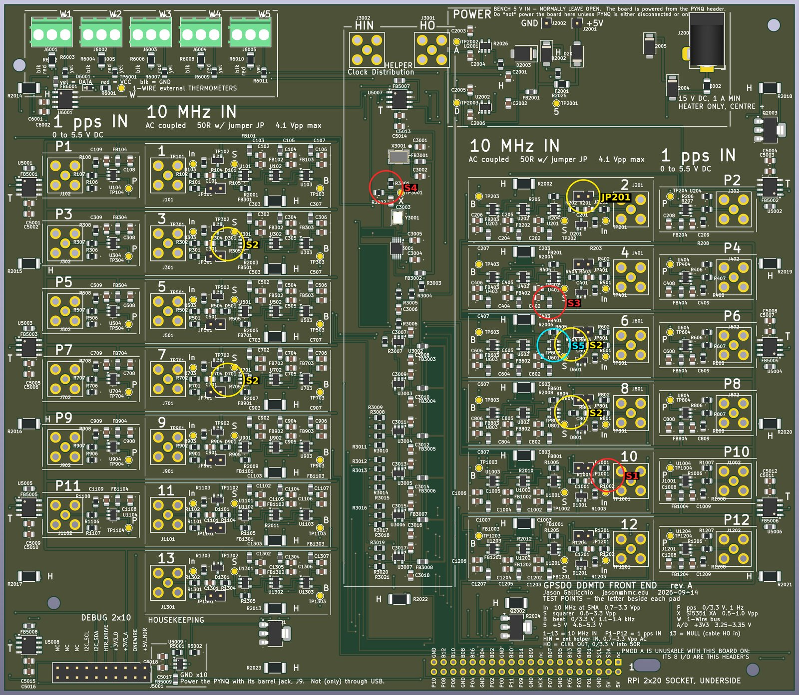

*The whole board.  Unit 6 carries both S2 and S5: it gets one or the other.*

### S1. One more SMA: unit 10 (J1001), with its 50R header and a shunt

- **Where.** J1001, the jack marked `10`, at (164.1, 125.0): right-hand
  column, the fifth jack down.  Its 2-pin header JP1001 is at (152.9, 121.6).
  Both solder from underneath.
- **Why.** RA7 wants four OCXO-fed units at the board's four corners:
  - **1** (top left), **2** (top right), **10** (lower right), **11** (lower
    left);
  - two in each column, and two near each end.
  - Then the heater's left-right gradient and any top-bottom one both show,
    and the room's even swings move all four alike.
  - Rev A's plan used unit 4 for this, but 4 sits 18 mm under 2, so only the
    left column saw top against bottom.
  - It also frees unit 4 for a locked generator (O4-O7).
- **Fit the shunt on JP1001.**

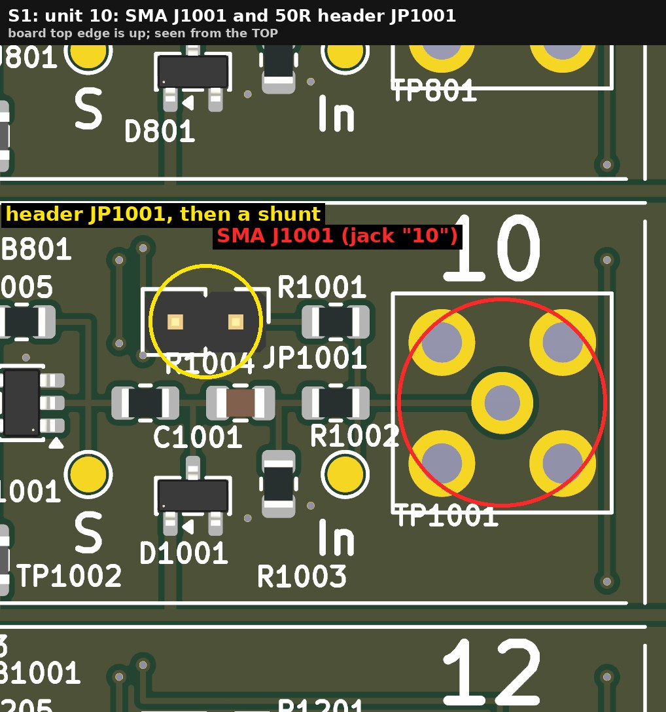

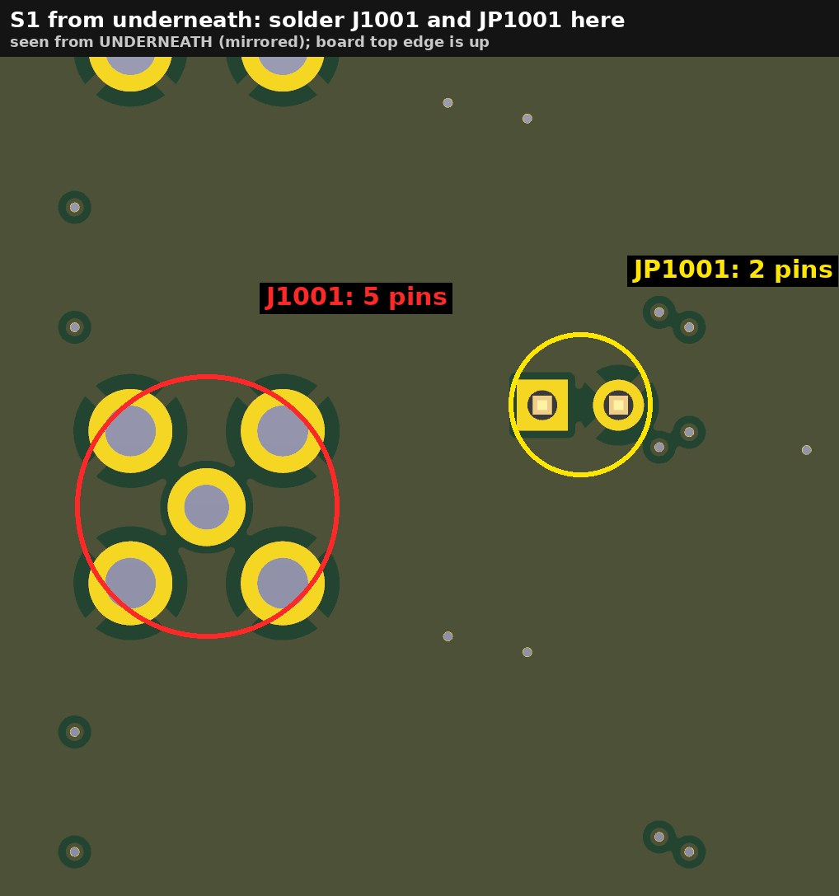

### S2. Park units 3, 7 and 8, and unit 6 unless you do S5: one 100 kΩ leaded resistor each

The same rework as unit 5 (round 45): from the squarer's gate node, the test
point `TPx02` (the pad marked `S`), to pin 2 (GND) of that unit's 50R header
`JPx01`, about 7.4 mm.

| Unit | From TP (gate node `S`) | To JP pin 2 (GND) | Why |
|---|---|---|---|
| 3 | TP302 (60.3, 59.7) | JP301 pin 2 (56.64, 66.1) | oscillates 29-30 of 30 since unit 5's park; a neighbour of unit 1 |
| 6 | TP602 (146.7, 92.4) | JP601 pin 2 (150.36, 86.0) | **skip if S5.** Oscillated 30 of 30 (round 41); a neighbour of unit 4 |
| 7 | TP702 (60.3, 95.3) | JP701 pin 2 (56.64, 101.7) | sometimes; a neighbour of unit 9 |
| 8 | TP802 (146.7, 110.2) | JP801 pin 2 (150.36, 103.8) | oscillated 30 of 30; a neighbour of unit 10 |

- On the left column a header's pin 2 is to the right of pin 1, and on the
  right column to the left of it.  If the header isn't fitted, the hole will
  do.  The PCB file checks: every `JPx01` pin 2 is GND.
- **Why.** These units oscillate at ~560 kHz whenever undriven.  Each is a
  local aggressor that changes state with its neighbours: parking unit 5 woke
  unit 3.  Parked, they can't confound anything tonight.  Rev B parks every
  unused channel (item 11), so the bench board becomes more like rev B.
- **Leave alone:**
  - unit 13: see S2b (it oscillates now);
  - unit 5 (parked already);
  - units 4 and 9 (generators drive them);
  - unit 6 if S5 makes it a channel.

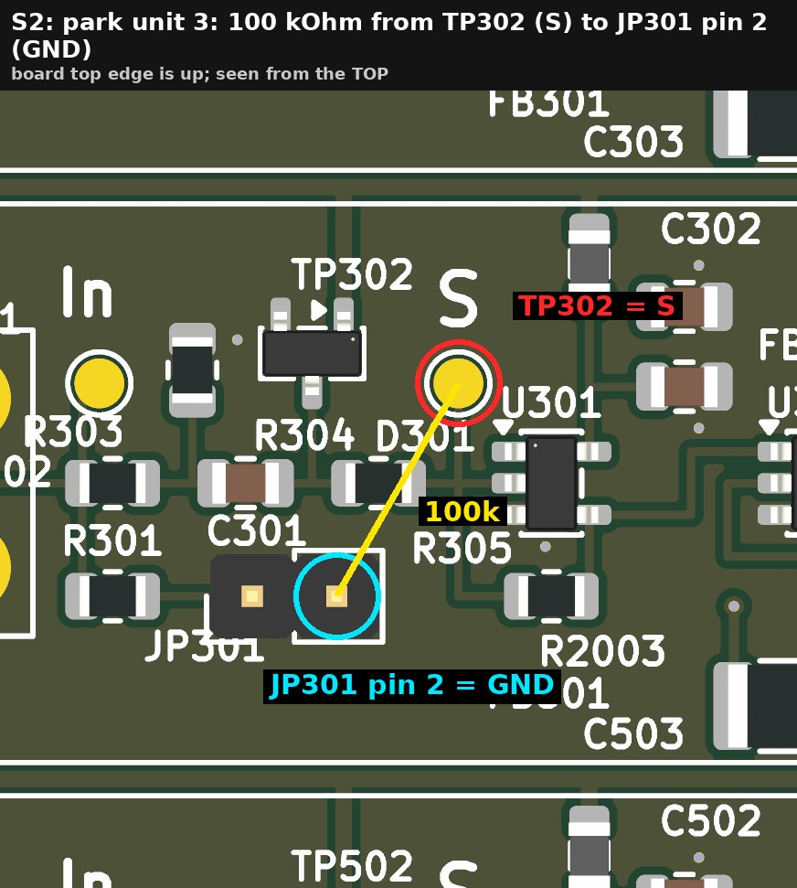

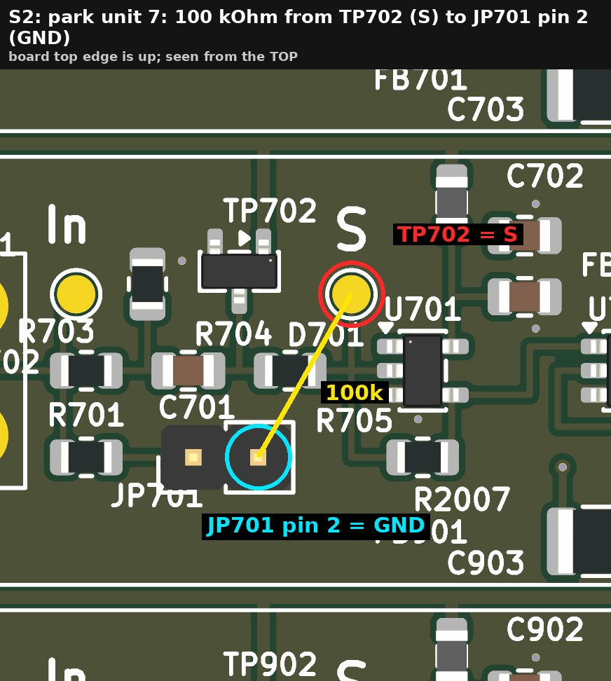

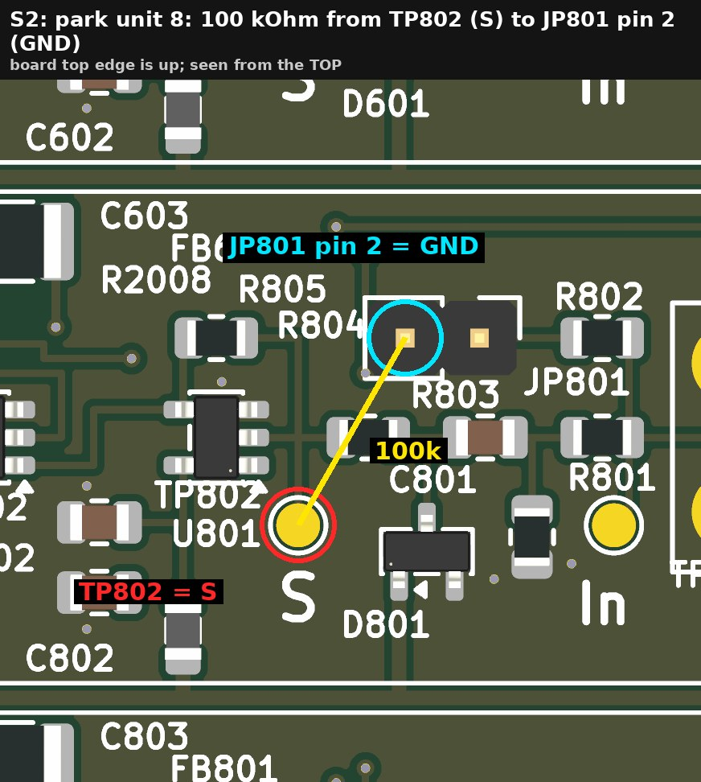

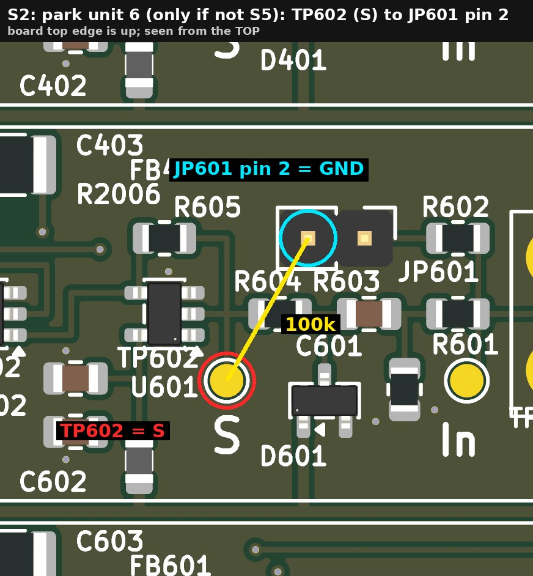

### S2b. Park unit 13 too (added after O2, 2026-10-08)

**O2 found unit 13 oscillating** at 582.5 kHz in 29 of 30 restarts, with
units 3, 5, 6, 7 and 8 parked and unit 4 undriven.  Unit 13 never oscillated
before.  It is the last undriven, unparked channel, so the oscillation moved
to it, as it moved to unit 3 when unit 5 was parked.  It sits beside unit 11,
one of N1's four corners.

- **100 kΩ from TP1302 (60.3, 148.7), the `S` pad, to JP1301 pin 2
  (56.64, 155.1), GND**: the same as the others, left column, bottom unit.
- With it in, **every channel is driven or parked**, which is rev B's rule
  (item 11).

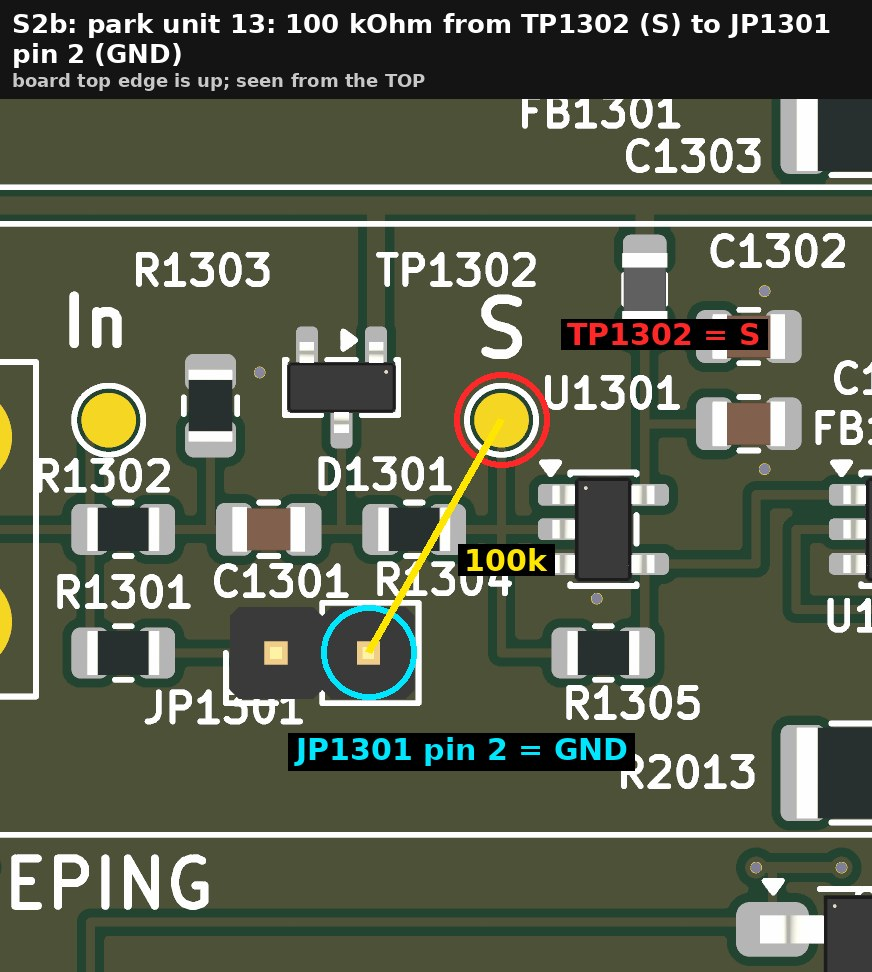

### S3. RA3: FB401's bridge becomes a 4.7 Ω 0805

- **Where.** Between FB401's pads, (142.76, 79.26) on the +3V3_A side and
  (142.76, 77.14) on the gate side.  It sits just below unit 4's squarer U401.
- **Why.** Rev B feeds every gate through a resistor instead of a bead
  (item 12), and this test picks the value.  O2 checks unit 4 stays quiet,
  and O7 measures what unit 4's state does to its neighbour, unit 2.
- **Skip it** if you don't have a 4.7 Ω 0805 (2.2-10 Ω will do; tell me which).

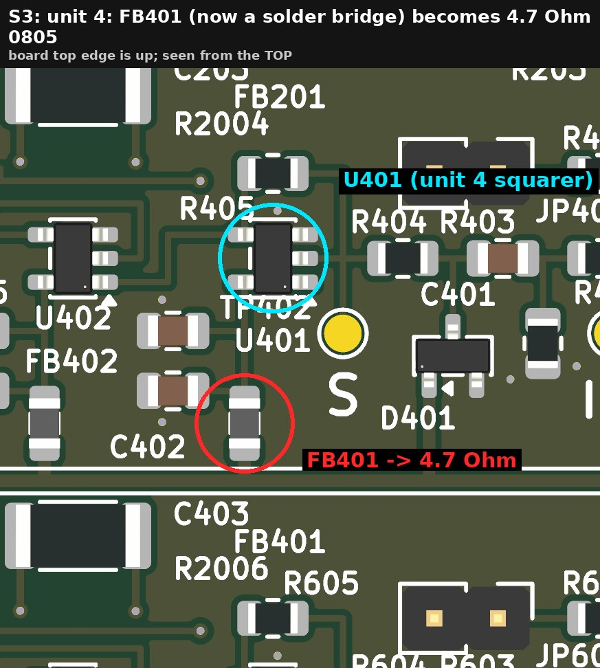

### S4. RA1: the XA drive, two 0805s by the TCXO

- **R3001, 3k3 → 1 kΩ**, at (101.25, 47.0), vertical; pads at (101.25, 46.09)
  (TCXO side) and (101.25, 47.91).
- **R3002, 1 kΩ → 330 Ω**, at (98.1, 49.4), horizontal; pads at (99.01, 49.4)
  and (97.19, 49.4) (GND).
- **Why.** Item 9: is the slow edge at the Si5351's XA what makes PLLA slip
  when CLK0 is at 4 mA?  O3 repeats the drive matrix, which doesn't depend on
  the input wiring, so round 45's matrix (`mods_20261007T2139Z`) is still the
  comparison.
- **Skip it** if it fights you: it is insurance for item 9, not a decision.

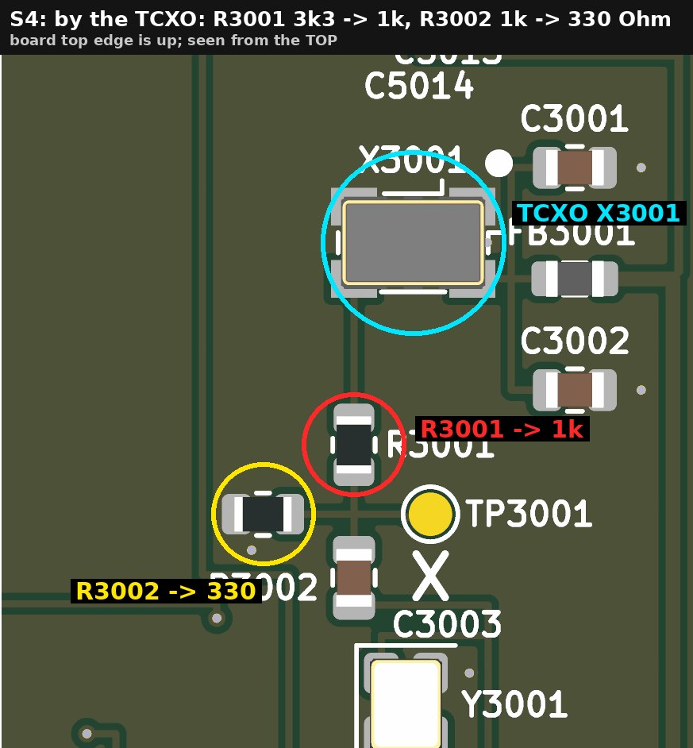

### S5 (optional). A lower-current squarer on unit 6, with its own SMA and 50R header

This is T8, which rev B's item 8 had given up on: **one channel's
74LVC1GU04 replaced by a 74AUP1GU04**.

**There is no 74AUP1GU04 anywhere on the board to take one from.**  Every
logic chip on rev A is an LVC part, so S5 needs a bought part.

| Chip | On each unit | What it does |
|---|---|---|
| 74LVC1GU04 (unbuffered inverter) | `Ux01` (and U3002) | **the squarer**: the one S5 replaces |
| 74LVC1G80 (D flip-flop) | `Ux02`, `Ux03` | the DDMTD sampler and the beat |
| 74LVC1G17 (Schmitt buffer) | `Ux04` | the pps input |
| 74LVC1G34 (buffer) | U3003-U3007 | the helper's distribution |

Without the part today, **park unit 6 now** (S2).  A leaded 100 kΩ is quick to
take off when the chip arrives.  Unit 6 then becomes a working channel,
driven by the spare right HP.  It is compared against unit 4: the same column,
the same jumper, the same kind of source, and still the LVC part.

1. **Remove U601** (74LVC1GU04, SOT-23-5) at (143.9, 89.4): hot air, or Chip
   Quik, or cut its five leads and clean the pads.
2. **Fit the new part.**  The pinout is the same: 1 NC, 2 A, 3 GND, 4 Y,
   5 VCC.
   - Pin 1 goes to the pad marked "pin 1" in the picture, at (145.04, 90.35).
     The part is rotated 180°, so pin 1 is at the lower right as drawn.
   - **The catch: the package.**
     - The 74AUP1GU04 is Nexperia's; TI doesn't make an unbuffered AUP.  It
       comes only as SC-70-5 (`74AUP1GU04GW`, SOT353: 0.65 mm pitch, about
       2.1 mm across the leads) or leadless.
     - The board's pads are SOT-23-5: 0.95 mm pitch, 1.3 × 0.6 mm pads,
       2.28 mm between the rows' centres.
     - Centred on the footprint, the SC-70's corner leads land on the inner
       edges of pads 1, 3, 4 and 5, and pin 2 sits on pad 2.  Use flux and
       very little solder.  Then check 1-2, 2-3 and 4-5 with a meter for
       bridges, and pin 2 to TP602 (`S`) for continuity.
   - **The easy alternative, in the same SOT-23-5 footprint:**
     `SN74AHC1GU04DBVR` (TI) or `74AHC1GU04W5-7` (Diodes).
     - That is an unbuffered inverter of an older, weaker family, so it
       should draw less current than the LVC when biased at threshold (not
       checked against a datasheet curve; O9 measures it).  But it isn't the
       part item 8 named.
     - It would make rev B a drop-in change.
     - **Tell me which part you fitted.**
3. **SMA on J601** (164.1, 89.4) and **header JP601** (152.9, 86.0), with a
   shunt, both from underneath.
4. **Don't park unit 6** (skip its S2 line).

- **Why.** Item 8 kept the LVC part only because this couldn't be tested.
  O9 compares unit 6 with unit 4 in:
  - per-transition jitter;
  - AM-to-PM;
  - whether it oscillates undriven;
  - the current it draws (the +3V3_A step when it goes driven ↔ 0 V).
- **If you don't get to it**, park unit 6 as in S2 instead.

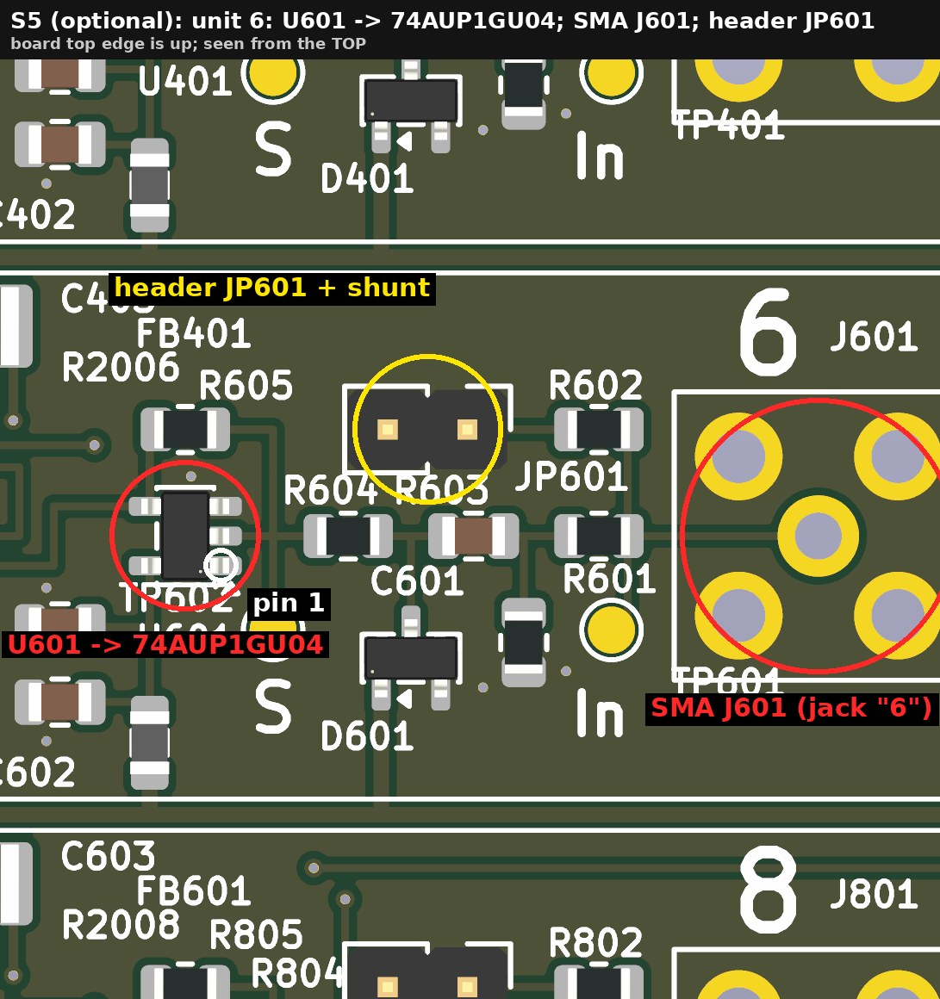

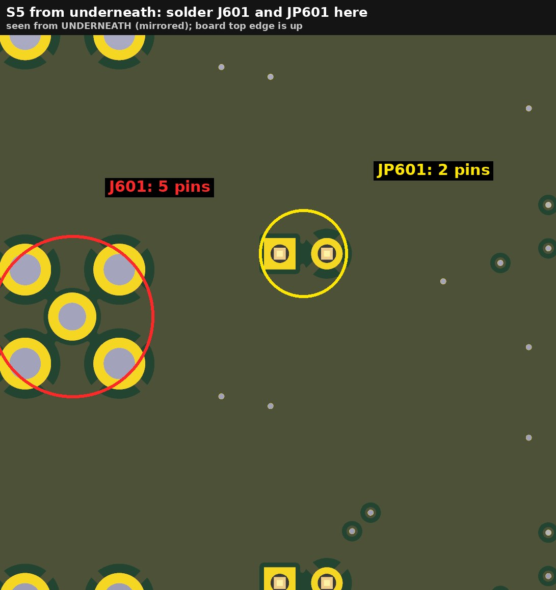

### More SMAs?  Only S1 (and S5's, if you do it)

- **What another SMA would buy:** a generator-driven unit.  There are already
  five locked outputs (three HPs, the SDG's two) for two free jacks (4 and 9).
- **What it costs:** a generator and a cable per unit, and another channel
  whose state changes.  Parking those units (S2) is cheaper, and it is what
  rev B does.
- **The exceptions:**
  - S1, because RA7 needs a fourth corner;
  - S5, whose new squarer needs a source to be measured at all.
- **Unit 13 (J1301)** would give a third aggressor position, next to unit 11.
  Not needed.

### Jumpers after soldering

| Unit | Jumper | Source |
|---|---|---|
| 1 | JP101 **fitted** (as now) | OCXO |
| 2 | JP201 **fit it** (it is off now) | OCXO: **needs it** |
| 4 | JP401 fitted (as now) | top HP |
| 6 | JP601 **fit it** (S5 only) | right HP |
| 9 | JP901 **off** (as now) | bottom HP, set to ≤ 3.3 Vpp open circuit |
| 10 | JP1001 **fit it** (S1) | OCXO |
| 11 | JP1101 fitted (as now) | OCXO |
| 12 | JP1201 fitted (as now) | HO |

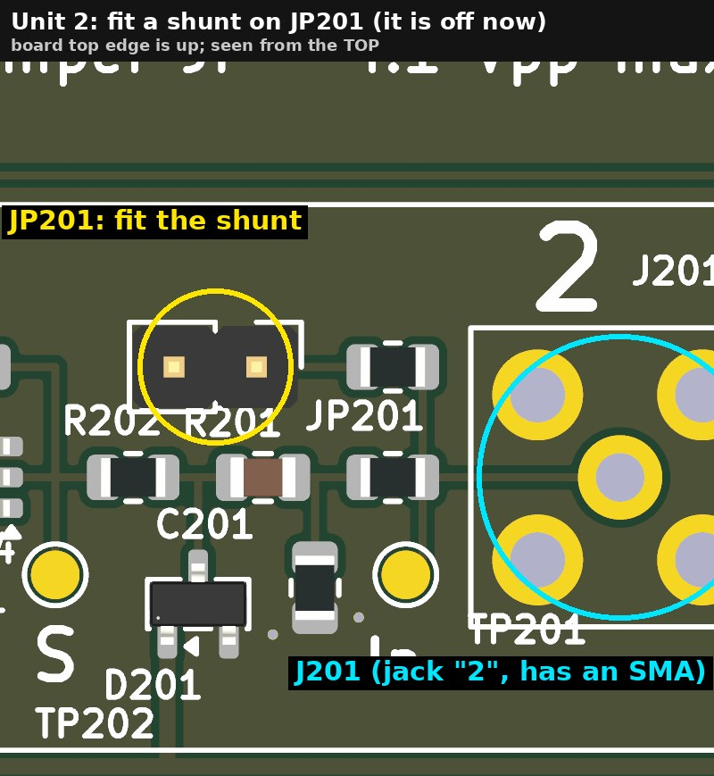

## 3. Wiring

### 3.1 OCXO left bank → the board, through tees on the scope

As before, put a **BNC tee directly on each scope input**: one cable from the
OCXO to the tee, a BNC-to-SMA from the tee to the board.

| # | OCXO port | Tee on | Board jack | Jumper |
|---|---|---|---|---|
| K1 | 1 | scope **CH1** | `1` (unit 1) | JP101 fitted |
| K2 | 2 | scope **CH2** | `2` (unit 2) | **JP201 fitted** |
| K3 | 5 | scope **CH3** | `10` (unit 10, S1) | **JP1001 fitted** |
| K4 | 6 | scope **CH4** | `11` (unit 11) | JP1101 fitted |

- **Four cables of the same type and length**, OCXO to tee.  Then four
  BNC-to-SMA of the same length, routed together.
  - Coax delay drifts with temperature, roughly 0.1-0.5 ps/K per metre.
    Unequal cables would put the room's swings into the pairs, and RA7 is
    after the board's own ~2.6 ps/K.
- **Pads (optional):** a 3 dB SMA attenuator at each board jack brings ~3.5 to
  ~2.5 Vpp.  Use them only if you have **four of the same value**.  Without
  them, 3.5 Vpp is inside the board's 4.1 Vpp ceiling.
- **Every port in one bank.**  Ports 1, 2, 5 and 6 are all the left bank, so
  all four are in phase.  O1 checks 5 and 6.

### 3.2 OCXO right bank → the instruments' references

| # | OCXO port | To | How |
|---|---|---|---|
| R1 | 3 | **SDG1032X** rear `10MHz In/Out` | **through a 50 Ω feed-through** (or a BNC tee with a 50 Ω terminator, or a 6 dB pad). Bare, it sees 6 Vpp. |
| R2 | 4 | **right HP** (GPIB 10) rear `10 MHz In` | direct (+14.9 dBm; its range is −10 to +15 dBm) |
| R3 | 7 | **top HP** (RS-232, `A9WV8RTV`) rear `10 MHz In` | direct |
| R4 | 8 | **bottom HP** (RS-232, `FTER3DQU`) rear `10 MHz In` | direct |

If the top and bottom HPs are already on two right-bank ports, leave them and
just tell me which.  A 3 dB pad on each HP would put it mid-range, but it
isn't needed.

### 3.3 Generators and HO → the board

| # | Source | Board jack | Notes |
|---|---|---|---|
| G1 | **top HP** OUTPUT (front) | `4` (unit 4) | the aggressor and AM-to-PM unit, right column, beside unit 2 |
| G2 | **bottom HP** OUTPUT | `9` (unit 9) | the same on the left column, beside unit 11. JP901 off |
| G3 | the board's `HO` (J3001) | `12` (unit 12) | **direct, no tee now** (CH3 is the OCXO's); the slip check reads its beat |
| G4 | **right HP** OUTPUT | **`6` (unit 6) if S5 is in**; otherwise nothing. Either way, unplug it from unit 11 | S5's source: terminated (JP601), at unit 4's level |
| G5 | SDG outputs 1 and 2 | **nothing** | outputs off; locked, as a spare |
| G6 | 33220A | **nothing**: it is off unit 4 | free-running; leave it on the LAN, output off |

- **Units 4 and 9 change source:**
  - unit 4 goes from the 33220A to the top HP;
  - unit 9 goes from CG-2's generator to the bottom HP (so **E2b goes**).
- I set every HP's amplitude before anything is driven.  Until then they sit
  at their power-on 1 kHz, 0.1 Vpp, which is harmless anywhere.

### 3.4 The scope

| Channel | What | Settings (I set them) |
|---|---|---|
| CH1 | tee of K1 (port 1, unit 1) | 1 MΩ, DC, 1×, 1 V/div |
| CH2 | tee of K2 (port 2, unit 2) | same |
| CH3 | tee of K3 (port 5, unit 10) | same |
| CH4 | tee of K4 (port 6, unit 11) | same |

The scope logs each OCXO line's amplitude all night.  The squarers convert
amplitude to phase at −150 to −230 ps/dB (item 18), so a port that drifts
0.01 dB moves its unit 2 ps.  RA7 has to see that, to tell it apart from the
board.  **Never set a channel to 50 Ω while it sits on a tee to the board.**

### 3.5 Unchanged

- **B**: power, network, console; the 15 V supply in J2003 for the heater.
- **E1**: CG-1 A on +5V_HDR (J5001 pin 1), CG-1 B on +3V3_A (pin 5), CG-2 A
  on +3V3_D (pin 7).
- **E2a**: CG-1's generator on `P2` (unit 2's pps), teed to CG-2 B.  Off.
- **The probe** in J6001.  Optional: tape it to the OCXO amplifier's case, so
  the night logs the OCXO's temperature as well (RA7's room-swing part).
- **Keep the board out of the sun** for the night: the blinds are behind it.

### 3.6 Map of the board, with today's assignments

```
 board's top edge (HO, HIN, 1-Wire terminals): toward the 33220A
        left column, x = 42.9                 right column, x = 164.1
 y  44.9  [ 1] OCXO port 1 (K1)
 y  53.8                                      [ 2] OCXO port 2 (K2), JP201 fit
 y  62.7  [ 3] parked (S2)
 y  71.6                                      [ 4] top HP (G1); 4.7 ohm (S3)
 y  80.5  [ 5] parked (round 45)
 y  89.4                                      [ 6] parked (S2), or S5: 74AUP1GU04, right HP
 y  98.3  [ 7] parked (S2)
 y 107.2                                      [ 8] parked (S2)
 y 116.1  [ 9] bottom HP (G2), no jumper
 y 125.0                                      [10] OCXO port 5 (K3): new SMA (S1)
 y 133.9  [11] OCXO port 6 (K4)
 y 142.8                                      [12] HO (G3)
 y 151.7  [13] null channel: parked (S2b)
 board's bottom edge (J5001): toward the PYNQ and the generator stacks
```

## 4. The tests

O = today, with nobody at the bench unless it says **hands**.  N = a night.
L = later.  Each says what it decides for rev B (`REVB_CHANGES.md` item).

### O0. The wiring check (10 min)

- Every instrument answers.
- **Each HP is locked:** its Questionable Data bit 6 is clear, and its unit
  beats at exactly the OCXO's rate.
- **Every driven unit beats:** 1, 2, 4, 9, 10, 11, 12.
- The scope sees four OCXO lines at ~3.5 Vpp (~2.5 with pads).
- The CircuitGears read their rails, and the probe answers.
- Nothing is changed.

### O1. The OCXO at the board (10 min)

- **What.** The six pairs among units 1, 2, 10 and 11, over 5 minutes.
- **Gives.**
  - Each pair's mean offset (cable plus port plus channel), and whether ports
    5 and 6 are in phase with 1 and 2.  A 180° port would show as 50 ns.
  - **The board's floor with no generator in any pair:** per-transition rms,
    and the pair's deviation at 1-100 s.  Round 45's SDG-fed unit 2 − unit 1
    was 32 ps rms per transition.
- **Decides.** The baseline every other test is read against.

### O2. Quiet when undriven (20 min): parks (S2) and RA3 (S3)

- **What.** `unplugged.py 30 1,2,9,10,11,12`, with the top HP at 0 V DC, so
  unit 4 is undriven.
- **Passes if** units 3, 5, 6, 7 and 8 are quiet 30 of 30 (parked), and unit 4
  is quiet with 4.7 Ω, as it was with the bridge.
- **Decides.** Item 12's resistor value, and item 11's park on every unused
  channel at once.

### O3. RA1, the drive matrix (30 min)

- **What.** CLK0 and CLK1 each at 2, 4, 6 and 8 mA; slips per second at each
  of the 16 settings; then back to the standard (CLK0 2 mA, CLK1 8 mA).
- **Against.** `mods_20261007T2139Z`: CLK0 at 4 mA slipped 865-1711 per
  second whenever CLK1 was at 4 mA or more.
- **Decides.** Item 9's weight.
  - **Clean at CLK0 4 mA**: the slow XA edge was the mechanism; CLKIN removes
    it, and the layout rules are insurance.
  - **Still slips**: supply and ground coupling too, so the separate VDDO
    banks and the guard ring matter as much as CLKIN.

### O4. AM-to-PM on units 4 and 9 (40 min): RA6, item 18

- **What.** Each HP at 10 MHz, stepped ±1 dB in 0.25 dB steps around its
  working level.  Unit 4 is terminated (JP401), unit 9 is not (JP901).  Read
  against the OCXO units, which nothing moves.
- **Against.** T3: unit 1 −231 ps/dB (terminated), unit 2 −147 ps/dB
  (unterminated), both read against the SDG, which wanders.
- **Decides.** Item 18 on two more units, with a reference that doesn't
  wander.
  - Is the spread between units bigger than between terminations?
  - Could a per-channel calibration replace the replica bias, or not?

### O5. Crosstalk with exact offsets (40 min): item 13

- **What.**
  - The top HP at 10 MHz + 0.5 Hz, then + 5 Hz, on unit 4; then the bottom
    HP the same on unit 9.
  - HO's drive at 2, 4, 6 and 8 mA and off.
  - The tone each puts into each OCXO pair, ps peak.
- **Against.** T2: no tone above 0.4 ps, but the floor then was the SDG's.
  This floor should be several times lower.
- **Decides.** Item 13: whether a neighbour at 18 mm couples at all, and how
  much more the near pair (4 → 2, 9 → 11) sees than the far ones.

### O6. HO's drive and the floor (15 min): item 10

- **What.** Per-transition jitter of the OCXO pairs, with HO at 2, 4 and 8 mA
  and off.
- **Against.** T2: 28.3 ps (off) to 32.7 ps (8 mA), on SDG pairs.
- **Decides.** Item 10's drive level, measured without the SDG's own jitter.
  N2 confirms it over a night.

### O7. A neighbour's state (20 min): T1 with RA3

- **What.** The top HP toggled between 10 MHz and 0 V DC every 90 s, 8 times.
  The step that unit 4's state puts on unit 2 (its neighbour) and on the
  others.
- **Against.** T1: +1.90 ps with the bead, +1.39 ± 0.38 ps with the bridge.
  Also changed since then: parks, and OCXO pairs in place of SDG ones.
- **Decides.**
  - **A step under ~0.5 ps**: local RC plus parking isolates neighbours.
  - **Still ~1.4 ps**: it is the shared +3V3_A, item 5's plane is the fix,
    and **L1** (the strap) shows it.

### O8. The port swap (hands: 2 min)

- **What.** At the OCXO, swap the cables of ports 1 and 6 (units 1 and 11)
  for 5 minutes, then swap them back.
- **Gives.** Pair 11 − 1's offset flips by the two ports' difference.  That
  separates what is the port from what is the channel, and checks the ports
  hold still.
- **Decides.** Whether RA7's per-channel numbers can be trusted to the
  picosecond.

### O9. The lower-current squarer (S5 only, 40 min): item 8

- **What.** Unit 6 (the new squarer) against unit 4 (LVC), both terminated,
  both from a locked HP at the same level:
  - per-transition jitter against the OCXO units;
  - AM-to-PM, both HPs stepped ±1 dB as in O4;
  - the +3V3_A step on CG-1 B when unit 6 goes driven ↔ 0 V DC, which is its
    current;
  - `unplugged.py` with unit 6 at 0 V: does it oscillate on its bead?
- **Decides.** Item 8.
  - **As good as the LVC, at a fraction of the current**: rev B can take it.
    With the SC-70 part that means a new footprint; with the AHC it is a
    drop-in.
  - **Worse**: item 8 stays NOT DOING, now on a measurement.

### N1. The night: RA7 (items 18 and 20)

- **What.** `overnight.py` with the heater stepped as in RA2: off 1 h, on 3 h,
  off 3 h, on 3 h, then off.  It logs:
  - the six OCXO pairs;
  - units 4 and 9 (HPs at exactly 10 MHz, locked: no beat tone, and no
    undriven unit 9);
  - unit 12 (slips);
  - the eight board thermometers, the probe, the rails and the heater;
  - the four OCXO lines' amplitudes.
- **Against.** RA2: +27.5 and +31.1 ps for ~11 K on SDG pairs.  The heater
  runs the left edge ~5 K hotter.
- **Decides.** Item 20 against item 18.
  - The heater warms the four corners in different proportions, and the room
    warms them alike.
  - **If the pairs follow the gradient (model B)**: thermal symmetry and an
    even heater are the fix (item 20).
  - **If each channel has its own coefficient on the mean (model A)**: the
    replica bias is the fix (item 18).
  - The heater steps are the clean part, because the OCXO and the cables stay
    at room temperature.

### N2. Tomorrow night: RA5 (item 10; no hands)

HO at 4 mA (`./pynq-run si_set.py 2 4`) for the whole night, in the same
wiring.  Against N1.  It decides whether rev A's firmware moves to 4 mA now,
and rev B's HO drive.

### L1. Later, if O7 asks: RA4, the +3V3_A strap (one wire)

An insulated AWG 22-24 wire, ~60 mm, from C2003 pad 1 (122.00, 7.95) to FB201
pad 1 (142.76, 61.46).  Then O7 again.  It decides whether the shared rail is
the coupling path, which item 5's plane removes.

### Day 2 (2026-10-09): all from here, no rearranging

Day 1's results are in README 45.20.  Two of them shape day 2:

- the helper tree carries noise between buffer groups (O1, O6, O8);
- the helper buffers U3003-U3007 sit on +3V3_A, through beads, beside every
  squarer.

| # | When (PDT) | What | Decides |
|---|---|---|---|
| **A1** | 05:30 | **N1's analysis.** Each corner's response to the heater: the instant step at switch-on (electrical) apart from the slow part (thermal), against the eight thermometers. Then the room's own swing. | item 20 against item 18: gradients (layout) or each channel's own coefficient (replica bias) |
| **O10** | 05:45 | **The helper's drive.** CLK0 at 2, 4, 6 and 8 mA (RA1 made 4-8 mA usable), HO at 2 mA: per-transition jitter within and across buffer groups. | item 22: does a faster helper edge cut the cross-group jitter? That sets the fan-out's edge rate and drive |
| **O11** | 06:05 | **The heater, toggled.** 60 s on, 60 s off, eight times: the instant step on each corner, before anything warms. | item 20: the heater's current return, kept off the channels' ground and the helper's supply |
| **O12** | 06:30 | **AM-to-PM against level.** Unit 9 (unterminated) at four levels, 1.0-2.9 Vpp open circuit, and unit 4 (terminated) at three. Each level ±0.5 dB with `VOLTage` only, inside one HP range. | item 18: whether a higher drive level alone shrinks AM-to-PM (O4: 176 ps/dB at ~1.5 Vpp, 23 at ~2.9), and the input level to print on rev B's silkscreen |
| **N2** | tonight | **A quiet night.** No heater, HO at 2 mA, the same logging. | the board's long-term floor between corners, and the OCXO against the TCXO: what a GPSDO comparison can resolve |

### L1, the +3V3_A strap: one wire, about 5 minutes, power OFF

**What you need:** one piece of insulated wire, AWG 22-24, about 70 mm, both
ends stripped and tinned about 1.5 mm.

1. **Tell me first.**  I stop the logger and shut the PYNQ down.  Then unplug
   the PYNQ's barrel jack and the 15 V heater supply.  Both ends are on the
   analog supply, and a slip with the board on would short it.
2. **End 1: the round test pad marked `A`** (TP2002), at the top of the
   board, beside the `HO` jack.  It is +3V3_A right at the regulator.  Keep
   clear of C2003's pad above it, which is ground.
3. **End 2: FB201's lower pad** (pad 1, the +3V3_A side) in unit 2's box,
   just below unit 2's squarer U201.  Not the upper pad: that one is the
   chip's own supply.
4. Lay the wire flat across the board between the two.  Nothing else.
5. Plug the PYNQ back in (then the heater supply), and tell me.  I bring it
   up and repeat O7.

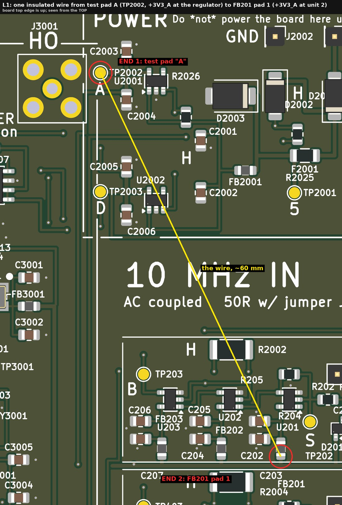

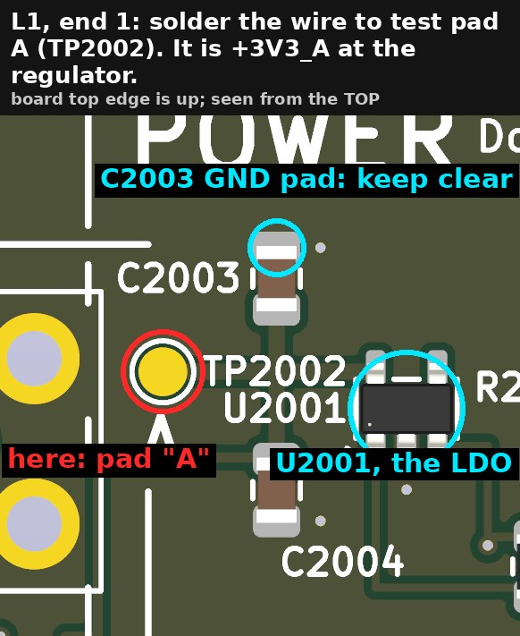

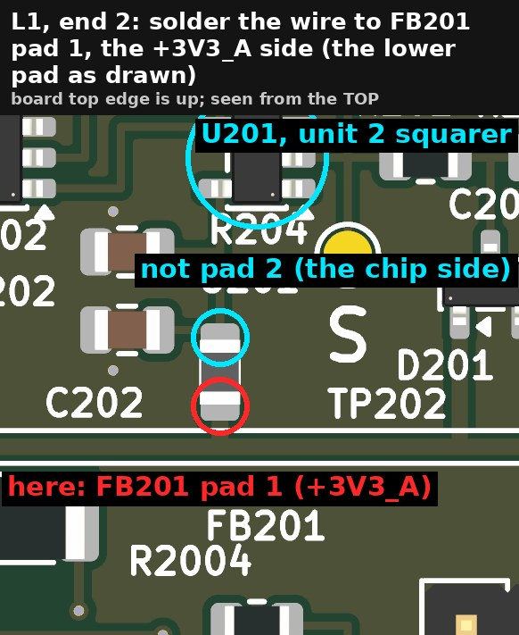

**What it tells:** if O7's 2-3 ps group shift shrinks with the strap in,
the shared +3V3_A is the path.  Item 22 gives rev B's helper fan-out its own
supply either way; this confirms why.

### Which test decides which rev B item

| Rev B item | Decided by |
|---|---|
| 5 +3V3_A plane (priority 1) | O7, L1 |
| 8 a lower-current squarer (NOT DOING) | O9 (S5) |
| 9 Si5351C, CLKIN (priority 1) | O3 |
| 10 HO isolated, 2-4 mA (priority 1) | O5, O6, N2 |
| 11 park unused channels (priority 1) | O2 |
| 12 RC gate filters (priority 1) | O2, O7 |
| 13 crosstalk rules | O5 |
| 22 the helper's fan-out (new) | O1, O6, O8, O10, L1 |
| 18 replica-biased squarers (priority 1) | O4, N1 |
| 20 heater and thermal layout | N1 |

## 5. What I change in the scripts (while you solder)

- `bench_setup.py`: the new sources.
  - The top and bottom HPs over RS-232 by their `/dev/serial/by-id` names, and
    the right HP on GPIB.
  - The SDG's outputs off and its clock on External (after R1).
  - The 33220A off.
  - Amplitudes: the top HP into unit 4's 50 Ω, the bottom HP ≤ 3.3 Vpp open
    circuit into unit 9.
- `overnight.py`, `crosstalk.py`, `toggle_test.py`, `xcheck.py amp`: units 1,
  2, 10 and 11 as the reference set.  The top and bottom HPs replace the SDG,
  the 33220A and the GPIB HP as the sources they step.
- `bench_wiring.csv`: this file's tables.

## 6. Don'ts (additions to `BENCH_WIRING.md` H)

- **No OCXO port into a board input without its 50R jumper.**
- **No OCXO port bare into the SDG**: through 50 Ω.
- The HPs have no output switch.  "Off" is 0 V DC (`off()`), which still
  terminates the line in 50 Ω.
- Don't move the four OCXO cables during N1.
